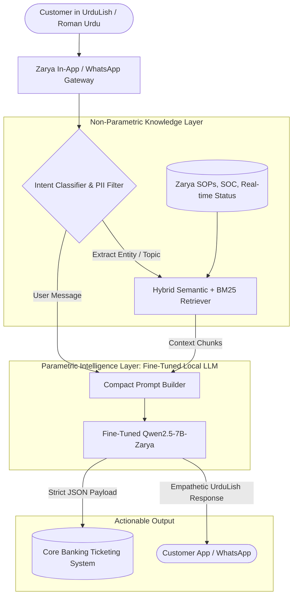

# Architectural Decision Document: Model Adaptation Strategy for Zarya Digital Bank

**Client:** Zarya Digital Bank (Fictional Scheduled Digital Retail Bank in Pakistan)  
**Scale:** 2 Million Active App Users | ~120,000 Support Inquiries/Day  
**Key Constraints:** State Bank of Pakistan (SBP) Data Sovereignty Regulations, High UrduLish Linguistic Nuance, Stringent Latency & Cost Controls  
**Document Version:** 1.0.0  
**Status:** Approved for Implementation  

---

## 1. Executive Summary & Problem Context

Zarya Digital Bank’s customer support ecosystem operates across three primary touchpoints: in-app chat, WhatsApp Business API, and telephony helpline transcripts. Over 85% of customer queries are articulated in **UrduLish** (an informal hybrid of Roman Urdu, Pakistani English, and localized banking jargon—e.g., *"Mera Raast transfer fail ho gaya lekin paise kat gaye"*, *"ATM se cash dispense nahi hua magar balance kat gaya"*).

An initial trial utilizing a commercial cloud-hosted model (e.g., OpenAI GPT-4o / GPT-3.5 via overseas API) demonstrated three prohibitive failures:
1. **Regulatory Non-Compliance & Data Privacy:** SBP’s BPRD Circular No. 03 of 2018 (Enterprise Technology Governance and Risk Management Framework) and BPRD Circular No. 04 of 2021 (Cloud Policy) explicitly forbid transmitting non-anonymized customer financial conversations, account identifiers, and transaction traces to multi-tenant servers situated outside sovereign jurisdiction.
2. **Unsustainable Unit Economics:** At 120,000 customer sessions per day averaging 4 turns each (~600 tokens/session), commercial API expenditures exceed **$18,000–$25,000 monthly**, scaling linearly with customer growth.
3. **Severe Linguistic & Domain Hallucinations:** Generic foundation models sound robotic, unnatural, or inappropriately formal in Roman Urdu/UrduLish, misinterpret localized terminology (e.g., confusing *Raast* instant payments with *IBFT* clearing or generic Wire transfers), and occasionally invent nonexistent refund windows or disputation procedures.

To establish an authoritative, compliant, and cost-effective solution, this document evaluates four architectural pathways and recommends a definitive strategy.

---

## 2. Comparative Matrix: Four Architectural Approaches

| Evaluation Criteria | 1. Prompt Engineering Only (Cloud API) | 2. Retrieval-Augmented Generation (RAG Only) | 3. Fine-Tuning Only (On-Prem OSS LLM) | 4. Hybrid: Fine-Tuning + RAG (Recommended) |
| :--- | :--- | :--- | :--- | :--- |
| **UrduLish Linguistic Quality & Tone** | **Medium-Low:** Tends to default to formal Urdu or stiff English. Struggles with colloquial Pakistani banking idioms, typos (*pesy*, *kat gye*), and anger cues. | **Medium:** Retrieves policy correctly, but response synthesis still relies on base model's intrinsic Roman Urdu fluency. Frequent syntax switching and unnatural phrasing. | **High:** Deeply internalizes colloquial UrduLish syntax, polite banking persona (*"Ji bilkul"*, *"Maazrat chahtay hain"*, respectful *"Aap"*), and tone modulation. | **Exceptional:** Flawless linguistic cadence and empathetic banking tone coupled with grounded factual precision. |
| **Factual Accuracy & Policy Grounding** | **Low-Medium:** Prone to hallucinating turnaround times (TAT), fee structures, and dispute policies when pushed outside context limits. | **High:** Injects authoritative banking documentation (e.g., Schedule of Bank Charges, Raast SOPs) directly into prompt context. | **Medium:** Encodes facts into parametric memory, which inevitably becomes stale or suffers slight drift over time. | **Near Perfect:** Parametric memory handles grammar, safety, and formatting; non-parametric vector index injects live bank policies and real-time operational status. |
| **Regulatory Privacy & SBP Compliance** | **Non-Compliant:** Off-premise egress of PII/financial chats violates SBP regulations; data residency cannot be guaranteed. | **Non-Compliant (if cloud) / Compliant (if on-prem):** If hosted entirely on local sovereign servers, privacy is preserved. | **Fully Compliant:** Self-hosted open-source model (e.g., Qwen2.5-7B or Llama-3.1-8B) on Zarya's Tier-3 local datacenter or private VPC in Karachi/Islamabad. | **Fully Compliant:** 100% on-premises execution. Embeddings, vector store (Qdrant/Milvus), and quantized LLM run within Zarya's isolated VPC. |
| **Inference Latency (SLA Target: <1.5s)** | **Variable (1.8s – 3.5s):** Trans-border internet transit hops + multi-tenant queuing latency. | **High (2.2s – 4.0s):** Vector retrieval (200ms) + large context window processing (1000+ tokens) increases Time-To-First-Token (TTFT). | **Low (0.6s – 1.1s):** Local quantized model (vLLM / TensorRT-LLM with AWQ/FP8) produces rapid TTFT with small prompt footprints. | **Low-Medium (0.9s – 1.4s):** Compact local retrieved context (top-2 chunks) fed into a fine-tuned model optimized for concise UrduLish generation. |
| **Cost at Scale (120k queries/day)** | **Extremely High:** ~$22,000+/month in variable API fees ($264k/yr), growing monotonically with user base. | **High (Cloud API) / Moderate (Local):** Long context prompts multiply per-token costs. Local deployment requires larger compute to ingest fat context. | **Low Fixed Cap:** Amortized hardware cost of 2x NVIDIA L40S or 4x RTX 6000 Ada (~$25k one-off cap-ex) amortized over 3 years = <$2,500/mo inclusive of power. | **Optimal TCO:** Fixed on-premise compute footprint. Amortized monthly cost is under $3,200 (including local vector DB and GPUs), saving >85% compared to APIs. |
| **Ease of Updating Policy / Knowledge** | **Instant:** Update system prompt text. | **Instant:** Update document chunks in vector database without retraining model. | **Difficult / Slow:** Requires weekly or monthly parameter retraining / LoRA updating whenever SOPs change. | **Instant:** Core bank policy, fee updates, branch hours, and Raast maintenance windows updated in vector DB in seconds without retraining weights. |
| **Structured Output Reliability (JSON)** | **Medium:** Occasional formatting leakage or markdown fences unless strictly forced via vendor-specific JSON modes. | **Medium:** Prone to schema deviations when distracted by large unstructured retrieved documents. | **High:** Model fine-tuned specifically on strict JSON schemas reliably outputs valid schemas for downstream ticket creation. | **Flawless:** Model fine-tuned on `<intent_ticket>` JSON templates reliably maps unstructured UrduLish complaints directly to Core Banking API payloads. |

---

## 3. Deep Dive into Architectural Options

### Option 1: Prompt Engineering Only
* **Mechanism:** Send system prompt containing bank tone guidelines, basic FAQs, and safety guardrails to an offshore frontier LLM API (e.g., GPT-4o-mini).
* **Why it Fails Zarya Bank:**
  1. **SBP Legal Barrier:** Transmitting banking chats containing partial account numbers, customer mobile numbers, or transaction disputes to foreign servers violates SBP Cyber Security Framework (CSF) Section 4.5.
  2. **Context Window Saturation:** Attempting to cram the entire Schedule of Bank Charges (SOC), dispute policies, Raast protocols, and fraud guidelines into the prompt exhausts token budgets and deteriorates instruction-following.
  3. **Linguistic Uncanny Valley:** Frontier models lack native calibration for Pakistani regional phonetics in Roman script, often misinterpreting words like *"kat"* (deducted vs cut) or *"phansa"* (stuck vs trapped).

### Option 2: RAG Only (Using Untuned Base Model)
* **Mechanism:** Index internal bank SOPs, FAQs, and circulars in a local Vector Database (e.g., Milvus or Qdrant). Retrieve relevant SOP passages and inject them into the base model prompt.
* **Why it is Insufficient Alone:**
  1. **Language Mismatch in Semantic Search:** Customer queries are in UrduLish (*"Raast transfer timeout hua but account debit hogya"*), whereas official bank SOPs are written in formal corporate English (*"Raast Direct Credit Dispute Handling Manual"*). Standard vector search without cross-lingual alignment suffers from poor recall.
  2. **Inability to Enforce Tone & Persona:** An off-the-shelf base model (e.g., standard Qwen2.5-7B or Llama-3.1-8B) will summarize English SOP chunks back to the user in robotic, transliterated English or awkward Urdu rather than empathetic, natural Pakistani banking UrduLish.
  3. **Safety Vulnerabilities:** Untuned models are easily jailbroken through prompt injection embedded inside customer complaint fields.

### Option 3: Fine-Tuning Only (No RAG)
* **Mechanism:** Fine-tune an open-source model (e.g., Qwen2.5-7B-Instruct) using Parameter-Efficient Fine-Tuning (QLoRA) on 3,000+ curated UrduLish banking dialogues.
* **Why it is Incomplete Alone:**
  1. **Knowledge Staleness & Hallucination:** Bank operational parameters fluctuate constantly (e.g., 1-Link ATM inter-bank switch maintenance, State Bank revised daily Raast transaction limits, tax withholding rates under FBR Section 236P). Fine-tuning cannot reliably memorize rapidly changing figures and is prone to hallucinating numbers when asked specific questions.
  2. **Risk of Silent Policy Drift:** If the bank reduces debit card replacement fees from PKR 1,500 to PKR 1,200, a fine-tuned model cannot be updated without retraining or risk of catastrophic forgetting.

### Option 4: Hybrid Strategy (Fine-Tuning + RAG) — The Winning Architecture
The hybrid architecture partitions responsibilities cleanly according to computational strengths:

1. **Parametric Memory (Fine-Tuning) handles:**
   - **Language & Cadence:** Fluency in UrduLish slang, Roman Urdu variations, regional phrasing, and empathetic politeness (*"Ji bilkul, main abhi check karta hoon"*).
   - **Persona & Brand Alignment:** Strict adherence to Zarya Bank's voice—never condescending, concise, reassuring.
   - **Zero-Failure Formatting:** Flawless generation of structured JSON tickets for automated integration into the core banking system (BPM/CRM).
   - **Defensive Alignment & Guardrails:** Instant, hard-coded refusal to solicit or process passwords, CVVs, or OTPs, neutralizing social engineering threats.

2. **Non-Parametric Memory (RAG) handles:**
   - **Dynamic Facts & Grounding:** Live Schedule of Charges, daily foreign exchange rates, real-time 1-Link/Raast switch uptime status, and seasonal promotional campaigns.
   - **Auditability:** Grounding customer answers in specific internal bank circular numbers for compliance traceability.

---

## 4. Financial & Regulatory Justification for Zarya Digital Bank

### 4.1 Cost-Benefit Breakdown (Annualized at 120,000 Queries/Day)
* **Cloud API Architecture:**
  - 120,000 queries * 30 days = 3.6M sessions/month.
  - At an average of 800 input tokens (including system prompt) + 150 output tokens = ~$0.005 per turn with GPT-4o-mini tier.
  - Monthly cost = **$18,000 – $22,000 USD** -> **~$240,000 USD / Year (PKR 67 Million)** in recurrent, variable operational expenses subject to foreign currency exchange volatility.
* **On-Premise Fine-Tuned + RAG Architecture:**
  - Hardware Requirement: 2x Dedicated Enterprise Server Nodes with 2x NVIDIA L40S (48GB) each, running vLLM with AWQ 4-bit / FP8 quantization.
  - Hardware Cap-Ex (one-time purchase amortized over 36 months): **$32,000 USD**.
  - Local Hosting, Power, and Monitoring: ~$1,000 USD/month.
  - Total Monthly Amortized Cost: **~$1,888 USD/month (PKR 525,000)**.
  - **Net Savings:** **>90% reduction in annual operational cost**, while insulating the bank from USD/PKR currency depreciation.

### 4.2 Regulatory Compliance
* **SBP Cyber Security Framework Compliance:** Customer communications remain strictly within the sovereign borders of Pakistan, satisfying data localization stipulations.
* **Zero Leakage Risk:** Zero training data retention or third-party telemetric monitoring.

---

## 5. Conclusion & Action Plan
The hybrid approach is not merely an engineering preference—it is an existential regulatory and operational necessity for Zarya Digital Bank. 

We will proceed with:
1. Formulating a rigorous **Data Specification** tailored for fine-tuning.
2. Generating a curated, high-diversity **3,000+ example synthetic dataset** in UrduLish.
3. Establishing clean **data filters, PII sanitizers, and quality auditing**.
4. Aligning a state-of-the-art open-source base model (Qwen2.5-7B) to power the bank's sovereign conversational engine.
