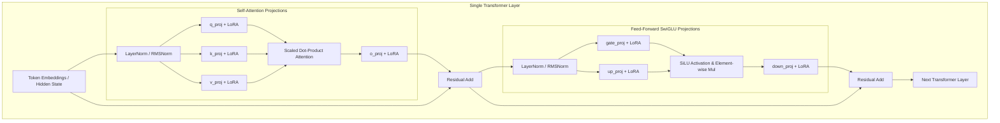

# Deep Dive: LoRA & QLoRA Theory Explained

**Document:** Mathematical & Engineering Foundations of Parameter-Efficient Fine-Tuning (PEFT)  
**Target Architecture:** Modern Decoder-Only Transformers (Qwen2.5, Llama-3.1, Mistral)  
**Author:** AI Engineering & Research Team  
**Status:** Educational & Reference Document  

---

## 1. What LoRA Does and Why It Needs So Little Memory

### 1.1 The Full Fine-Tuning Bottleneck
When you perform **Full Fine-Tuning (FFT)** on a 7-Billion parameter model (e.g., `Qwen2.5-7B` or `Llama-3.1-8B`), you don't just load the model weights you have to track gradients and optimizer states for every single weight parameter during backpropagation.

In standard FP16/BF16 training with the industry-standard **AdamW** optimizer:
- **Base Model Weights:** 7B params $\times$ 2 bytes = **14 GB**
- **Gradients:** 7B params $\times$ 2 bytes = **14 GB**
- **AdamW Optimizer States:** 
  - 1st momentum ($m_t$): 7B $\times$ 4 bytes (FP32) = **28 GB**
  - 2nd momentum ($v_t$): 7B $\times$ 4 bytes (FP32) = **28 GB**
  - Master FP32 weights copy: 7B $\times$ 4 bytes = **28 GB**
- **Activations & KV Cache:** ~**8–16 GB** (depending on sequence length and batch size)
- **Total VRAM required for Full Fine-Tuning 7B:** **~80–110 GB VRAM** (Requires at least an A100/H100 80GB GPU or multi-GPU setup with DeepSpeed ZeRO-3 / FSDP).

For a growing digital bank like Zarya, full fine-tuning on on-premises GPUs is prohibitively expensive and inflexible.

---

### 1.2 The LoRA Solution: Low-Rank Adaptation
Proposed by Edward Hu et al. (Microsoft, 2021), **LoRA** rests on a profound empirical insight:  
> *When adapting a pre-trained foundation model to a specific downstream task, the weight update matrix $\Delta W$ has a very low "intrinsic rank".*

That is, the model does not need to adjust all degrees of freedom in its vast multidimensional space. Most meaningful adaptation happens along a small subspace of dimensions.

Instead of updating the full weight matrix $W_0 \in \mathbb{R}^{d \times k}$:

$$W = W_0 + \Delta W$$

LoRA **freezes** the pre-trained weights $W_0$ completely and decomposes the update matrix $\Delta W$ into the product of two low-rank matrices:

$$\Delta W = B \times A$$

Where:
- $W_0 \in \mathbb{R}^{d \times k}$ (Frozen original weights)
- $A \in \mathbb{R}^{r \times k}$ (Initialized with random Gaussian $\mathcal{N}(0, \sigma^2)$)
- $B \in \mathbb{R}^{d \times r}$ (Initialized to **all zeros**)
- $r \ll \min(d, k)$ (Rank, typically $r = 8, 16, 32$)

```
             Full Fine-Tuning (FFT)                     LoRA Architecture
                                                   
           Input x (dim d)                                Input x (dim d)
                 │                                        ┌──────┴──────┐
                 ▼                                        │             ▼
         ┌──────────────┐                                 │      ┌─────────────┐
         │              │                                 │      │ Matrix A    │ (r x d)
         │  W = W0 + ΔW │ (d x k)                         │      │ (Gaussian)  │
         │  (Train All) │                                 │      └──────┬──────┘
         │              │                                 │             │ (dim r)
         └───────┬──────┘                                 │             ▼
                 ▼                                        │      ┌─────────────┐
           Output h (dim k)                               │      │ Matrix B    │ (k x r)
                                                 Frozen   │      │ (Zeros)     │
                                                 Weight   │      └──────┬──────┘
                                                  W0      │             │
                                                (d x k)   │             │ * (alpha / r)
                                                          ▼             ▼
                                                        ┌────────────────┐
                                                        │     h = W0 x   │
                                                        │   + (B A x)    │
                                                        └───────┬────────┘
                                                                ▼
                                                          Output h (dim k)
```

### 1.3 Why Does LoRA Start with Zero Output?
Because matrix $B$ is initialized entirely to **zero**:

$$\Delta W = B \times A = 0 \times A = 0$$

At Step 0 of training:
$$h = W_0 x + \Delta W x = W_0 x + 0 = W_0 x$$

The model starts in the exact baseline state of the pre-trained foundation model. There is no sudden perturbation or degradation of initial capabilities when training starts.

### 1.4 Why LoRA Slashes Memory Consumption
1. **$W_0$ is 100% Frozen:** Zero gradients are calculated for $W_0$.
2. **Zero Optimizer States for Base Model:** AdamW does not maintain momentum or variance buffers for the billions of frozen parameters.
3. **Tiny Adapter Footprint:** With rank $r = 16$, the trainable parameters drop from 7,000,000,000 (7B) to **~20,000,000 (20M)** a **>99.7% reduction** in trainable parameters.
4. **Arithmetic Example for a single linear projection ($d = 4096, k = 4096$):**
   - Full matrix parameters: $4096 \times 4096 = \mathbf{16,777,216}$ parameters.
   - LoRA matrices with $r = 16$: $(4096 \times 16) + (16 \times 4096) = 65,536 + 65,536 = \mathbf{131,072}$ parameters.
   - **Parameter reduction for that layer:** $\frac{131,072}{16,777,216} = \mathbf{0.78\%}$ (a 128x parameter reduction!).

---

## 2. Rank ($r$), Alpha ($\alpha$) and Target Modules

### 2.1 What Rank ($r$) Really Means
The rank $r$ defines the **dimensional capacity of the bottleneck**.
- Geometrically, $A$ compresses the input feature representation from high dimension $d$ down to a compact subspace $r$. Then, $B$ expands it back up from $r$ to output dimension $k$.
- **If $r$ is too small (e.g., $r = 2$ or $4$):** The adapter may underfit, struggling to learn new linguistic cadences (like UrduLish slang or complex JSON schema constraints).
- **If $r$ is moderate ($r = 8$ or $16$):** The sweet spot for almost all domain adaptation, tone alignment, and classification tasks.
- **If $r$ is excessively large (e.g., $r = 128$ or $256$):** Defeats parameter efficiency, increases VRAM footprint, and increases the likelihood of overfitting on small datasets.

### 2.2 Scaling Factor: The Role of $\alpha$ (Alpha)
When the adapter output is added back to the frozen base output, it is scaled by a constant factor:

$$h = W_0 x + \left( \frac{\alpha}{r} \right) B A x$$

Where:
- $\alpha$ is a constant hyperparameter.
- $\frac{\alpha}{r}$ acts as a **learning rate multiplier** for the adapter updates.

#### Why do we need $\alpha$?
If you decide to experiment with different ranks (e.g., test $r = 8$, then change to $r = 16$, then $r = 32$), the magnitude of the matrix multiplication $B \times A$ scales with the rank. 

Without $\alpha$, doubling $r$ would require you to re-tune your learning rate from scratch. By fixing the ratio:

$$\text{Scale} = \frac{\alpha}{r}$$

When you scale $r$ and scale $\alpha$ proportionally (e.g., keeping $\alpha = 2 \times r$), you keep the gradient dynamics stable across different rank choices.
- **Industry Convention:** Set $\alpha = 2 \times r$ (e.g., $r = 16, \alpha = 32$) or set $\alpha = 16$ fixed.

---

### 2.3 Target Modules: Where to Attach LoRA
In a Decoder-Only Transformer (like Qwen2.5 or Llama-3.1), every Transformer block consists of:
1. **Multi-Head Self-Attention:**
   - `q_proj` (Query projection)
   - `k_proj` (Key projection)
   - `v_proj` (Value projection)
   - `o_proj` (Output attention projection)
2. **Feed-Forward MLP (SwiGLU):**
   - `gate_proj` (Gating projection)
   - `up_proj` (Up-projection)
   - `down_proj` (Down-projection)



#### Which modules should you target?
- **Original LoRA Paper (2021):** Only targeted `q_proj` and `v_proj`.
- **Modern Best Practice (QLoRA Paper / SOTA LLM Fine-Tuning):** **Target ALL linear layers** (`q_proj, k_proj, v_proj, o_proj, gate_proj, up_proj, down_proj`).
  - Empirical research shows targeting all linear projection layers with a lower rank (e.g., $r = 16$) yields significantly superior performance compared to targeting only $W_q$ and $W_v$ with a higher rank (e.g., $r = 64$).
  - In PEFT config:
    ```python
    target_modules=["q_proj", "k_proj", "v_proj", "o_proj", "gate_proj", "up_proj", "down_proj"]
    ```

---

## 3. QLoRA: 4-bit Base Model + LoRA Adapters

QLoRA (Tim Dettmers et al., May 2023) revolutionized LLM fine-tuning by demonstrating that you can **quantize the base model down to 4 bits** without sacrificing fine-tuning accuracy.

With QLoRA, a 7B or 8B parameter model can be fine-tuned on a **single consumer GPU with 12GB to 16GB VRAM** (e.g., RTX 3060/4070 or T4/V100 on cloud).

```
┌────────────────────────────────────────────────────────────────────────┐
│                          QLoRA Execution Architecture                  │
│                                                                        │
│   Frozen 4-Bit Base Weights (NF4)         16-Bit LoRA Adapters (BF16)  │
│   ┌─────────────────────────────┐         ┌────────────────────────┐   │
│   │  W0 in 4-bit NormalFloat    │         │ Matrix A: BF16 Weights │   │
│   │  (Occupies ~4.5 GB VRAM)    │         │ Matrix B: BF16 Weights │   │
│   └──────────────┬──────────────┘         └───────────┬────────────┘   │
│                  │                                    │                │
│                  │ Dequantize on-the-fly              │                │
│                  │ to BF16 per layer                  │                │
│                  ▼                                    ▼                │
│   ┌─────────────────────────────┐         ┌────────────────────────┐   │
│   │  W0 in temporary BF16       │         │ Adapter Output (BF16)  │   │
│   │  h_base = W0 * x            │         │ h_lora = (B * A * x)   │   │
│   └──────────────┬──────────────┘         └───────────┬────────────┘   │
│                  │                                    │                │
│                  └─────────────────┬──────────────────┘                │
│                                    ▼                                   │
│                        Combined Hidden State                           │
│                      h = h_base + (alpha/r)*h_lora                     │
│                                    │                                   │
│                  ┌─────────────────┴─────────────────┐                 │
│                  ▼                                   ▼                 │
│        Backward Pass (Gradients)          AdamW Updates                │
│        Base Weights: Frozen (No grad)     Adapters Only: Updated in    │
│        Zero VRAM gradient memory          BF16/FP32 via AdamW          │
└────────────────────────────────────────────────────────────────────────┘
```

### 3.1 The Three Core Innovations of QLoRA

#### Innovation 1: NormalFloat4 (NF4) Data Type
Standard integer quantization (like INT4) divides numbers into evenly spaced bins. However, pre-trained neural network weights are not uniformly distributed they follow a **zero-centered Gaussian (Normal) distribution**:

$$W \sim \mathcal{N}(0, \sigma^2)$$

Integer bins waste information density in the tails where few weights exist, and have poor resolution near zero where most weights concentrate.

**NF4** creates 16 discrete intervals whose bin boundaries are constructed such that each bin contains an **equal number of expected parameters** from an empirical normal distribution:
- Information-theoretically optimal for normally distributed weights.
- Preserves foundation model reasoning and perplexity significantly better than standard 4-bit uniform quantization.

#### Innovation 2: Double Quantization (DQ)
When you quantize weights into 4-bit blocks (typically block size $B = 64$ parameters), each block requires a 32-bit floating-point quantization constant ($c_1$) to scale the 4-bit integers back to real numbers:
- 32 bits per 64 parameters = **0.5 bits per parameter** overhead!
- For a 7B model, this overhead alone consumes **~500 MB VRAM**.

**Double Quantization** treats the quantization constants themselves as numbers to be quantized:
- Quantizes the first-stage constants ($c_1$) into 8-bit floats with a second-stage block size of 256.
- Drops the scaling overhead from 0.5 bits/param down to **0.127 bits/param** (saving ~373 MB VRAM with zero loss in accuracy).

#### Innovation 3: Paged Optimizers
During long-context training or complex batch iterations, sudden memory allocation spikes can cause an Out-Of-Memory (OOM) crash.
- QLoRA leverages **NVIDIA CUDA Unified Memory** to allocate page memory for the optimizer states.
- If GPU VRAM experiences an instantaneous peak, page buffers automatically page inactive AdamW optimizer states out to system RAM, and page them back when needed.

---

## 4. Full Fine-Tuning vs LoRA   When to Use Which

| Comparison Axis | Full Fine-Tuning (FFT) | LoRA / QLoRA |
| :--- | :--- | :--- |
| **Compute Hardware Required** | Multi-GPU cluster with 80GB VRAM GPUs (A100/H100) and DeepSpeed ZeRO-3 / FSDP. | Single mid-tier enterprise GPU (L40S, A10G) or consumer card (RTX 3090/4090, T4). |
| **Trainable Weights** | 100% of weights (~7 to 8 Billion). | 0.2% – 1.0% of weights (~20 to 50 Million). |
| **Catastrophic Forgetting Risk** | **High:** Massively overwrites pre-trained general knowledge and reasoning circuits. | **Very Low:** Base knowledge is frozen in place; adapters only steer style, format, and domain tone. |
| **Deployment Footprint** | Multi-model serving requires loading separate 14GB–16GB model weights for each specialized use-case. | **Zero Model Redundancy:** Keep 1 base model in VRAM, dynamically swap lightweight **30MB–80MB adapter files** per tenant. |
| **Training Speed** | Fast per step (no dequantization overhead), but constrained by cluster network communication. | Slight dequantization overhead in QLoRA (typically 15–20% slower per step than 16-bit LoRA), but massive batch efficiency. |
| **When to Use** | 1. Pre-training a model from scratch.<br>2. Radically new languages with non-Latin scripts (e.g., training a pure Sindhi or Pashto LLM from zero).<br>3. When billions of continuous compute tokens are available. | 1. Enterprise domain adaptation (UrduLish banking, legal contracts, medical support).<br>2. Tone, style, and persona alignment.<br>3. Structured JSON / tool-use enforcement.<br>4. High privacy / on-premise budgetary constraints. |

---

## 5. Chat Templates and Why Loss Is Computed ONLY on Assistant Tokens

### 5.1 The Role of Chat Templates
Foundation models are originally trained on raw causal text completion: they simply predict the next token given prior tokens.
To turn a raw text completer into an interactive conversational agent, we structure the conversation into explicit roles:
1. `system`: The governing instructions, brand persona, and safety boundaries.
2. `user`: The customer's raw inquiry or complaint.
3. `assistant`: The bank's helpful, compliant response.

Modern models use standardized chat templates (e.g., **ChatML** for Qwen2.5, `<|begin_of_text|>` for Llama-3):
```text
<|im_start|>system
Aap Zarya Digital Bank ke official AI assistant hain...<|im_end|>
<|im_start|>user
Mera Raast transfer fail ho gaya lekin paise kat gaye<|im_end|>
<|im_start|>assistant
Ji, maazrat chahtay hain ke aap ko pareshani hui...<|im_end|>
```

---

### 5.2 Why Loss Must Be Computed ONLY on Assistant Tokens (Instruction Masking)

In standard autoregressive language modeling, Cross-Entropy Loss is calculated over all target tokens:

$$\mathcal{L} = - \sum_{t=1}^{T} \log P(x_t \mid x_1, x_2, \dots, x_{t-1})$$

If you compute loss over the **entire prompt** (system prompt + customer query + assistant reply), you commit a fatal training mistake known as **Target Leakage / Prompt Memorization**.

```
Training Sequence:
[SYSTEM PROMPT]  ────────>  [USER QUERY]  ────────>  [ASSISTANT RESPONSE]
  "Aap Zarya..."             "Mera Raast..."           "Ji, maazrat..."
       │                           │                          │
       ▼                           ▼                          ▼
   Labels: -100                Labels: -100            Labels: Real Token IDs
(Masked from Loss)          (Masked from Loss)         (Loss Computed Here!)
```

#### The Three Catastrophic Failures of Training on User Tokens:
1. **Model Learns to Generate Customer Complaints Instead of Answering:**
   - If the model is penalized for failing to predict the user's words (*"Mera Raast transfer fail ho gaya"*), it uses its finite capacity trying to learn how customers formulate complaints, rather than learning how the bank should answer.
2. **Degenerate Repetition Loops in Production:**
   - Models trained without label masking often echo the user's prompt back to them, or hallucinate a customer turn right after finishing an answer:
     - *Customer:* "Debit card block karna hai."
     - *Defective Model:* "Ji block kar diya. Mera Raast transfer bhi fail ho gaya tha kal..." (hallucinating next user message).
3. **Loss Skewing on Long System Prompts:**
   - In a complex enterprise system with a 400-token system prompt and a 50-token assistant response, 88% of the gradient updates would be spent optimizing prediction of the static system prompt. The model's training loss would appear artificially low while its actual conversational helpfulness remains terrible.

### 5.3 PyTorch Implementation: The Magic of `labels = -100`
In PyTorch's `torch.nn.CrossEntropyLoss`, the parameter `ignore_index` defaults to `-100`:
```python
loss_fn = torch.nn.CrossEntropyLoss(ignore_index=-100)
```
Any token in the target `labels` tensor set to `-100` contributes **zero** to the gradient calculation during backpropagation:

```python
# Simplified Instruction Masking Implementation
input_ids = tokenizer.encode(full_chatml_text)
labels = list(input_ids)

# Find the start index of the assistant's turn
assistant_start_idx = find_subsequence(input_ids, tokenizer.encode("<|im_start|>assistant\n"))

# Mask everything prior to assistant response with -100
for i in range(assistant_start_idx):
    labels[i] = -100

# Now the model ONLY learns:
# P(assistant_tokens | system_prompt, user_query)
```

By ensuring loss is computed exclusively on assistant tokens, the model concentrates 100% of its learning capacity on mastering **empathy, policy adherence, fraud refusals, and deterministic JSON ticketing payloads**.
