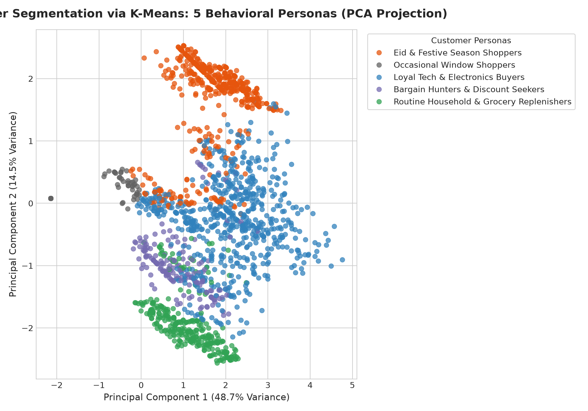

# ShopKaro Customer Segmentation & Persona Strategy

This report synthesizes customer segmentation derived from **RFM (Recency, Frequency, Monetary)** scoring combined with unsupervised **K-Means clustering** across 25,000 customer accounts.

---

## 1. Segment Overview & Economic Contribution

| Persona Name | Customers | User Share | Median Recency | Avg Orders | Median Spend (PKR) | Total GMV Share |
| :--- | :--- | :--- | :--- | :--- | :--- | :--- |
| **Bargain Hunters & Discount Seekers** | 1,715 | 6.9% | 331 days | 1.4 | Rs. 4,286 | **1.7%** |
| **Eid & Festive Season Shoppers** | 4,356 | 17.4% | 378 days | 1.4 | Rs. 102,999 | **31.6%** |
| **Loyal Tech & Electronics Buyers** | 5,323 | 21.3% | 92 days | 4.7 | Rs. 109,697 | **64.7%** |
| **Occasional Window Shoppers** | 11,095 | 44.4% | 365 days | 0.0 | Rs. 0 | **0.1%** |
| **Routine Household & Grocery Replenishers** | 2,511 | 10.0% | 342 days | 1.3 | Rs. 8,999 | **2.0%** |

---

## 2. In-Depth Persona Profiles & Recommended Marketing Actions

### 👤 Bargain Hunters & Discount Seekers
- **Scale:** 1,715 users (6.9% of base) | **Revenue Contribution:** 1.7% of total GMV
- **Behavioral Pattern:** Price-sensitive deal seekers browsing flash sale tabs and clearance sections. High view count, selective purchases under Rs. 2,000.
- **Payment Preference:** Cash on Delivery (COD)
- **Recommended Marketing Action:**
  > **Action:** Dynamic Flash-Sale notifications with countdown urgency banners ('Only 3 hours left: Flat 40% Off Under Rs. 1,999') + free shipping threshold vouchers.

---

### 👤 Eid & Festive Season Shoppers
- **Scale:** 4,356 users (17.4% of base) | **Revenue Contribution:** 31.6% of total GMV
- **Behavioral Pattern:** Spike buyers during Ramadan, Chaand Raat, Eid ul-Fitr, and 11.11. Dominated by unstitched lawn, stitched festive kurtas, footwear, and perfumes.
- **Payment Preference:** Cash on Delivery (COD) & EasyPaisa
- **Recommended Marketing Action:**
  > **Action:** Automated WhatsApp & SMS campaigns 14 days before Chaand Raat offering 'Guaranteed Eid Delivery by 27th Ramadan' + early access VIP festival vouchers.

---

### 👤 Loyal Tech & Electronics Buyers
- **Scale:** 5,323 users (21.3% of base) | **Revenue Contribution:** 64.7% of total GMV
- **Behavioral Pattern:** High-value ticket buyers purchasing inverter ACs, smartphones, LED smart TVs, and official warranty gadgets. High basket size with low visit frequency.
- **Payment Preference:** Debit/Credit Card & Bank Transfer
- **Recommended Marketing Action:**
  > **Action:** Offer 0% markup instalment plans (Buy Now Pay Later / BNPL via Alfa/Silkbank) + extended warranty coverage bundle on checkout.

---

### 👤 Occasional Window Shoppers
- **Scale:** 11,095 users (44.4% of base) | **Revenue Contribution:** 0.1% of total GMV
- **Behavioral Pattern:** Infrequent visitors with high bounce rates and low cart adds. High recency inactivity (>180 days). At high risk of dormancy.
- **Payment Preference:** Undetermined / COD
- **Recommended Marketing Action:**
  > **Action:** Re-engagement drip sequence: 'ShopKaro Misses You — Here is Rs. 500 off your first order over Rs. 2,500' displayed on personalized homepage carousels.

---

### 👤 Routine Household & Grocery Replenishers
- **Scale:** 2,511 users (10.0% of base) | **Revenue Contribution:** 2.0% of total GMV
- **Behavioral Pattern:** Consistent monthly recurring orders for basmati rice, cooking oil, tea, lentils, and detergent. High retention and high frequency.
- **Payment Preference:** JazzCash & COD
- **Recommended Marketing Action:**
  > **Action:** 'Subscribe & Save' 1-click replenishment feature with free Sunday delivery slots for orders above Rs. 4,000.

---
