# ShopKaro E-Commerce Platform — Data Model & ER Diagram

This document specifies the relational and analytical schema for the **ShopKaro AI Commerce Intelligence Platform**. The schema is optimized for both transactional integrity (orders, sessions, events) and high-throughput OLAP analytics (DuckDB, Parquet) supporting recommendation models and demand forecasting.

---

## 1. Visual Entity-Relationship (ER) Diagram

```mermaid
erDiagram
    USERS ||--o{ SESSIONS : "initiates"
    USERS ||--o{ EVENTS : "performs"
    USERS ||--o{ ORDERS : "places"
    USERS ||--o{ REVIEWS : "writes"
    USERS ||--|| USER_MAPPING : "indexed_by"

    PRODUCTS ||--o{ EVENTS : "targeted_in"
    PRODUCTS ||--o{ REVIEWS : "evaluated_in"
    PRODUCTS ||--|| ITEM_MAPPING : "indexed_by"

    SESSIONS ||--o{ EVENTS : "contains"
    SESSIONS ||--o| ORDERS : "converts_to"

    CALENDAR ||--o{ EVENTS : "temporal_context_for"
    CALENDAR ||--o{ ORDERS : "seasonal_context_for"

    USERS {
        string user_id PK "Unique identifier (USR-XXXXX)"
        string full_name "Customer full name"
        string city "City (Karachi, Lahore, Islamabad, etc.)"
        timestamp registration_date "Account creation timestamp"
        string preferred_payment "COD, JazzCash, EasyPaisa, Card"
        string phone_prefix "Mobile network code (0300, 0321, etc.)"
        string device_preference "Android, iOS, Desktop"
    }

    PRODUCTS {
        string product_id PK "Unique SKU ID (PROD-XXXXX)"
        string sku "Stock Keeping Unit code"
        string title "Product title with brand and attributes"
        string category "Top-level department (Fashion, Electronics, etc.)"
        string subcategory "Specific product type"
        string brand "Pakistani brand name (Khaadi, Dawlance, etc.)"
        int price_pkr "Current selling price in PKR"
        int cost_pkr "Wholesale inventory cost in PKR"
        string price_tier "Budget, Mid-Range, Premium, Luxury"
        int stock_quantity "Current inventory warehouse units"
        string description "Textual product specifications"
        float rating_avg "Average star rating (1.0 to 5.0)"
        boolean is_active "Catalogue visibility status"
    }

    SESSIONS {
        string session_id PK "Session token (SES-USER-INDEX)"
        string user_id FK "Reference to USERS"
        timestamp session_start "First event timestamp"
        timestamp session_end "Last event timestamp"
        int event_count "Total actions in session"
        int views_count "Product view count"
        int carts_count "Add to cart count"
        int purchases_count "Completed purchase count"
        float duration_minutes "Total duration (30-min inactivity rule)"
        boolean is_converted "Flag indicating checkout conversion"
    }

    EVENTS {
        string event_id PK "Unique interaction ID (EVT-XXXXXXXX)"
        string session_id FK "Reference to SESSIONS"
        string user_id FK "Reference to USERS"
        string product_id FK "Reference to PRODUCTS"
        string event_type "view, add_to_cart, purchase"
        timestamp timestamp "Exact datetime of action"
        string user_agent "Client device & browser signature"
        int user_int_id FK "Contiguous 0-indexed integer for ML"
        int item_int_id FK "Contiguous 0-indexed integer for ML"
    }

    ORDERS {
        string order_id PK "Order number (ORD-XXXXXXX)"
        string session_id FK "Reference to SESSIONS"
        string user_id FK "Reference to USERS"
        timestamp order_date "Checkout timestamp"
        int total_items "Total units in cart"
        int order_total_pkr "Gross merchandise value (GMV) in PKR"
        int order_margin_pkr "Net gross profit in PKR"
        string payment_status "Completed, Pending, Refunded"
        string shipping_method "TCS/Trax, Express City, Postal"
    }

    REVIEWS {
        string review_id PK "Review identifier (REV-XXXXXX)"
        string product_id FK "Reference to PRODUCTS"
        string user_id FK "Reference to USERS"
        int rating "Star rating from 1 to 5"
        string review_text "Customer review in Roman Urdu, Urdu, or English"
        string language "Roman Urdu, Urdu, English"
        string sentiment "positive, neutral, negative"
        date created_at "Review submission date"
    }

    CALENDAR {
        date date PK "Calendar date (2024-01-01 to 2025-12-31)"
        int year "Year (2024, 2025)"
        int month "Month (1 to 12)"
        string day_of_week "Monday through Sunday"
        boolean is_weekend "Saturday / Sunday flag"
        boolean is_festival "True during Ramadan, Eid, 11.11, etc."
        string festival_name "Pakistani event name or Regular Day"
        float demand_multiplier "Empirical demand boost factor (1.0 to 3.6x)"
        string affected_categories "Targeted categories affected by festival"
    }

    USER_MAPPING {
        string user_id PK "Original user string ID"
        int user_int_id "Contiguous index [0, N-1] for ALS / PyTorch"
    }

    ITEM_MAPPING {
        string product_id PK "Original product string ID"
        int item_int_id "Contiguous index [0, M-1] for ALS / PyTorch"
    }
```

---

## 2. Table Specifications & Constraints

| Table Name | Primary Key | Foreign Keys | Partitioning / Index Strategy | Purpose |
| :--- | :--- | :--- | :--- | :--- |
| **`users`** | `user_id` | - | Indexed on `city`, `preferred_payment` | Master user identity and demographics |
| **`products`** | `product_id` | - | Indexed on `category`, `brand`, `price_tier` | Product catalogue with PKR pricing & margins |
| **`calendar`** | `date` | - | Indexed on `date`, `is_festival` | 2-year Pakistani retail & religious festival calendar |
| **`sessions`** | `session_id` | `user_id` | Indexed on `user_id`, `session_start` | 30-minute inactivity sessionized customer visits |
| **`events`** | `event_id` | `user_id`, `product_id`, `session_id` | Clustered on `timestamp`, indexed on `user_id`, `product_id` | Cleaned clickstream events (view, cart, purchase) |
| **`orders`** | `order_id` | `session_id`, `user_id` | Indexed on `user_id`, `order_date` | Financial transactions and GMV records |
| **`reviews`** | `review_id` | `product_id`, `user_id` | Indexed on `product_id`, `language` | Multilingual customer feedback (UrduLish, Roman Urdu, English) |
| **`user_mapping`** | `user_id` | `user_id` | In-memory lookup / Join | Contiguous integer ID mapping for Recommender Systems |
| **`item_mapping`** | `product_id` | `product_id` | In-memory lookup / Join | Contiguous integer ID mapping for Recommender Systems |

---

## 3. Business Context & Design Decisions

1. **Dual Representation (String vs Integer IDs)**:
   - Web applications, APIs, and client tracking use readable string IDs (`USR-00123`, `PROD-04512`).
   - Collaborative filtering (Implicit ALS, LightFM, PyTorch Two-Tower) requires dense contiguous integer indices `0 <= i < N`. `user_mapping` and `item_mapping` provide bi-directional zero-overhead resolution.
2. **Session Boundary Definition (30-Minute Inactivity Rule)**:
   - In accordance with e-commerce industry standard (Google Analytics 4 / Adobe Analytics), consecutive events with an elapsed time $\Delta t > 30\text{ minutes}$ trigger a new session boundary.
3. **Pakistani Market Specifics**:
   - `preferred_payment`: Accommodates high Cash on Delivery (COD) dominance (~68-70%) along with mobile wallets (JazzCash, EasyPaisa) and banking cards.
   - `calendar`: Models non-Gregorian lunar events (Ramadan, Eid ul-Fitr, Eid ul-Adha) which shift by ~10-11 days annually, crucial for demand forecasting.
