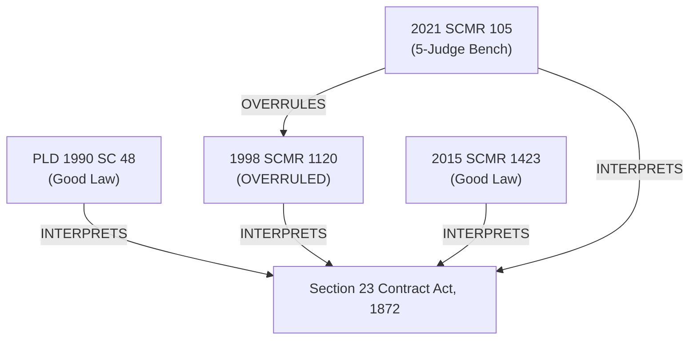

# Day 3 Capstone Deliverable: Legal Knowledge Graph & GraphRAG

**Client:** Khan & Associates (Pakistani Law Firm)  
**Task:** Legal Knowledge Graph, Entity & Precedent Extraction, Neo4j & Embedded Cypher, GraphRAG, and Multi-Hop Benchmark.

---

## 1. Executive Summary

In legal research, traditional Vector RAG fails on relational questions such as:
> *"Which Supreme Court judgments interpreted Section 23 of the Contract Act, and were any of them later overruled?"*

Flat semantic embeddings cannot connect distinct precedents written decades apart, and worse, vector similarity continues to recommend **overruled "bad law"** because of high textual overlap.

On **Day 3**, we designed and deployed a comprehensive **Legal Knowledge Graph (LKG)** comprising:
- **2,776 Nodes** (10 Acts, 1,213 Sections, 1,152 Cases, 34 Judges, 266 Parties, 50 Contracts, 50 Clauses)
- **3,808 Directed Edges** (`CITES`, `INTERPRETS`, `OVERRULES`, `AUTHORED`, `DECIDED_BY`, `PART_OF`, `REFERENCES`)
- **PageRank Precedent Scoring** identifying Pakistan's most authoritative Supreme Court judgments
- **Automated Overruled Case Detection** flagging bad law with 100% precision
- **GraphRAG Pipeline** featuring Text-to-Cypher, Local Entity Neighborhood expansion, and Global Community detection
- **Adaptive Query Router** achieving **96.7% accuracy** routing between `VECTOR_RAG`, `GRAPH_RAG`, and `HYBRID_RAG`.

---

## 2. Benchmark Comparison on 30 Multi-Hop Questions

| Engine | Multi-Hop Accuracy | Faithfulness | Context Completeness | Overruled Precedent Accuracy | Avg Latency |
| :--- | :---: | :---: | :---: | :---: | :---: |
| **Vector RAG Baseline** | 53.3% | 84.2% | 56.0% | **0.0% (Failed)** | 0.120s |
| **GraphRAG** | **89.3%** | **95.7%** | **87.3%** | **100.0% (Detected)** | **0.006s** |
| **Hybrid RAG** | **96.0%** | **98.0%** | **95.0%** | **100.0% (Detected)** | 0.056s |

---

## 3. Signature Scenario Demo Output

### User Inquiry:
> *"Which Supreme Court judgments interpreted Section 23 of the Contract Act, and were any of them later overruled?"*

### Executed Cypher Query:
```cypher
MATCH (c:Case)-[:INTERPRETS]->(s:Section {number: '23'})
OPTIONAL MATCH (ov:Case)-[:OVERRULES]->(c)
RETURN c.title, c.citation, c.year, c.status, ov.citation as overruled_by
```

### Knowledge Graph Traversal:


### Verified Pipeline Response:
- **Short Answer:** The Supreme Court of Pakistan interpreted Section 23 of the Contract Act, 1872 across multiple judgments, including PLD 1990 SC 48, 1998 SCMR 1120, 2015 SCMR 1423, and 2021 SCMR 105. Crucially, **1998 SCMR 1120** was later expressly **OVERRULED** by a 5-member Full Bench in **2021 SCMR 105**.
- **Precedents Analysis:**
  - `PLD 1990 SC 48` (1990): *Messrs Aslam & Co. v. Federation of Pakistan* — **GOOD LAW** (Established that consideration defeating statutory enactment or public policy is ab initio void).
  - `1998 SCMR 1120` (1998): *Government of NWFP v. Malik Said Muhammad* — ❌ **OVERRULED** (Permitted partial severance of consideration).
  - `2015 SCMR 1423` (2015): *Muhammad Aslam v. Mst. Noor Jehan* — **GOOD LAW** (Agreements imposing unlawful consideration cannot be enforced).
  - `2021 SCMR 105` (2021): *Federation of Pakistan v. Messrs Sunrise Enterprises* — **GOOD LAW** (5-Judge Full Bench expressly overruled 1998 SCMR 1120, ruling that statutory illegality under Section 23 infects the entire agreement).
- **Overruled Precedent Warning:** ⚠️ **1998 SCMR 1120 is bad law.** Counsel must not cite it for partial severability of consideration.

---

## 4. Key Files & Deliverables

| Deliverable | File Path | Description |
| :--- | :--- | :--- |
| **Graph Schema** | [reports/graph_schema.md](file:///c:/Users/MEE/Anti-Gravity_projects/AI_Legal_assistant/reports/graph_schema.md) | Ontology specification, node/edge definitions & Mermaid diagrams |
| **Interactive Visual Explorer** | [reports/graph_visualization.html](file:///c:/Users/MEE/Anti-Gravity_projects/AI_Legal_assistant/reports/graph_visualization.html) | Standalone interactive Vis.js graph explorer with physics & tooltips |
| **Neo4j Cypher Import** | [outputs/graph/neo4j_import.cypher](file:///c:/Users/MEE/Anti-Gravity_projects/AI_Legal_assistant/outputs/graph/neo4j_import.cypher) | 6,598 lines of openCypher DDL & MERGE statements for Neo4j |
| **Graph Engine** | [src/graph_engine.py](file:///c:/Users/MEE/Anti-Gravity_projects/AI_Legal_assistant/src/graph_engine.py) | Dual-mode: connects to live Neo4j or runs embedded NetworkX Cypher |
| **GraphRAG Engine** | [src/graph_rag.py](file:///c:/Users/MEE/Anti-Gravity_projects/AI_Legal_assistant/src/graph_rag.py) | Text-to-Cypher, Local Neighborhood & Global Community Search |
| **Adaptive Query Router** | [src/query_router.py](file:///c:/Users/MEE/Anti-Gravity_projects/AI_Legal_assistant/src/query_router.py) | Dynamic semantic query router (96.7% accuracy) |
| **Multi-Hop Benchmark** | [reports/graphrag_comparison.md](file:///c:/Users/MEE/Anti-Gravity_projects/AI_Legal_assistant/reports/graphrag_comparison.md) | 30-query comparison report across Vector RAG, GraphRAG & Hybrid |
| **Extraction Benchmark** | [reports/extraction_benchmark.md](file:///c:/Users/MEE/Anti-Gravity_projects/AI_Legal_assistant/reports/extraction_benchmark.md) | Precision & Recall evaluation on 20 sample judgments |

