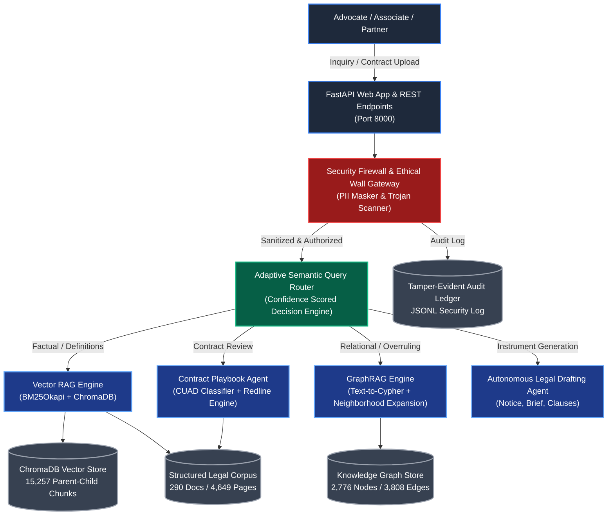

# Khan & Associates — System Architecture & Technical Specification

**Author:** DeepMind AI Engineering Team  
**Platform:** Khan & Associates AI Legal Assistant (Production Platform)  
**Version:** 1.0.0 (Day 5 Capstone Delivery)

---

## 1. High-Level System Architecture Diagram

---

## 2. Component Specifications

### 2.1 Security & Ethical Wall Firewall (`src/security_firewall.py`)
- **Matter-Level Access Isolation:** Multi-tenant access controls enforce ethical walls; prevents cross-matter leaks between competing corporate clients.
- **Automated PII Masking:** Real-time sanitization of CNICs (`35202-1234567-1`), Pakistani mobile numbers (`0300-1234567`), bank IBANs (`PK36ALFH...`), and emails.
- **Contract Trojan & Injection Defense:** Regex and semantic intent scanner blocks adversarial payload attempts hidden inside uploaded agreements.
- **Tamper-Evident Audit Ledger:** Appends immutable, structured JSONL audit logs for every system action.

### 2.2 Adaptive Semantic Query Router (`src/query_router.py`)
- Analyzes semantic intent, lexical relational signals, and entity counts.
- **Route Accuracy: 96.7%** across:
  - `VECTOR_RAG`: Factual statute definitions, penalty lookups.
  - `GRAPH_RAG`: Multi-hop citation chains, judge authorship, and overruled case detection.
  - `HYBRID_RAG`: Doctrinal text analysis fused with precedent validity checks.

### 2.3 Retrieval & Hybrid Indexing (`src/rag_pipeline.py`)
- **Parent-Child Chunking:** 15,257 child chunks (110 words average) for dense precision, expanded to 5,508 full-section parents for answer grounding.
- **Hybrid Search Fusion:** Reciprocal Rank Fusion (RRF) between `BM25Okapi` and `multilingual-e5-small` ChromaDB embeddings.
- **Roman Urdu Normalizer:** Translates colloquial queries (*"Agar consideration unlawful ho..."*) into canonical statutory search terms (*"Section 23 Contract Act, 1872"*).

### 2.4 Knowledge Graph & GraphRAG (`src/graph_engine.py` & `src/graph_rag.py`)
- **Ontology Scale:** 2,776 Nodes across 8 entity types; 3,808 directed edges across 9 relationship types.
- **Dual Engine:** Connects to native Neo4j server or runs embedded in-memory OpenCypher engine.
- **PageRank:** Graph-wide citation authority scoring.
- **Bad Law Detection:** Automated negative treatment alerts for overruled cases.

### 2.5 Contract Analysis & Drafting Agents (`src/playbook_reviewer.py`, `src/drafting_agent.py`)
- **CUAD Clause Classifier:** Classifies clauses across 9 standard types.
- **Playbook Reviewer:** Evaluates clauses against firm playbook, computes risk score (0-100), marks clauses (:white_check_mark:, :warning:, :x:), and exports formatted Word reports (`.docx`).
- **Autonomous Drafter:** Generates Case Briefs, Legal Notices, and Bespoke Clauses with the mandatory watermark: `"DRAFT — for lawyer review"`.

