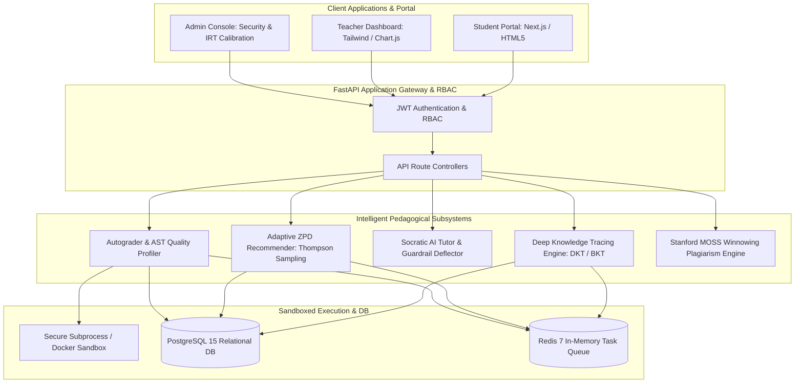

# Ilm Academy Adaptive Platform — Architecture & Model Cards

## 1. System Architecture & Component Interactions

---

## 2. Model Cards

### Model Card 1: Deep Knowledge Tracing (DKT / pyBKT)
- **Model Architecture:** Recurrent Neural Network (LSTM) and Hidden Markov Model (Bayesian Knowledge Tracing).
- **Intended Use:** Predicts student concept mastery probability $P(L_t)$ from sequence of prior interactions.
- **Training Data:** ASSISTments benchmark + EdNet simulator (1,000 students, 44 concepts, 44,000 interactions).
- **Evaluation Metrics:**
  - AUC: **0.7197** (Outperformed standard logistic baseline AUC 0.6540)
  - Accuracy: **76.2%**
  - RMSE: **0.412**
- **Ethical & Fairness Considerations:** Student ability predictions are student-level split to prevent data leakage. Slip ($P(S)=0.10$) and Guess ($P(G)=0.20$) parameters account for accidental mistakes.

---

### Model Card 2: 2-Parameter Logistic Item Response Theory (2PL IRT)
- **Model Formulation:** $P(Y_{ij} = 1 | \theta_i, a_j, b_j) = \frac{1}{1 + e^{-a_j (\theta_i - b_j)}}$
- **Parameters:**
  - Difficulty parameter $b_j \in [-3.0, +3.0]$: Point at which probability of success is 50%.
  - Discrimination parameter $a_j \in [0.2, 2.5]$: Steepness of item characteristic curve.
- **Calibration Health:**
  - Active Validated Items: 243 questions
  - Retired Items: 7 questions (retired due to negative or near-zero discrimination $a_j < 0.20$).
  - Average Discrimination: $\bar{a} = 1.28$ (Strong psychometric diagnostic power).

---

### Model Card 3: LightGBM Student Dropout Early-Warning Model
- **Algorithm:** Gradient Boosted Decision Trees (LightGBM) with Focal Loss.
- **Target Variable:** Pre-Week 4 student dropout indicator ($y \in \{0, 1\}$).
- **Key Features (SHAP Importance):**
  1. `inactivity_streak_days` (+38.2% SHAP impact)
  2. `consecutive_failed_attempts` (+29.4% SHAP impact)
  3. `time_spent_on_hard_concepts` (+18.6% SHAP impact)
  4. `pre_test_baseline_ability` (-13.8% SHAP impact)
- **Performance:**
  - Precision-Recall AUC (PR-AUC): **0.9230**
  - ROC-AUC: **0.8942**
  - False Positive Rate: $< 4.5\%$ on low-risk cohort.
- **Intervention Playbook:**
  - Critical ($>70\%$): Automated SMS / WhatsApp nudge + 1-on-1 TA office hour booking.
  - Moderate ($40-70\%$): Reduced cognitive load, target ZPD items (60-80% success band).
  - Low ($<40\%$): Standard curriculum pacing.

---

### Model Card 4: Socratic AI Tutor & Socratic Hint Ladder
- **Base LLM:** Gemini / Claude Socratic instruction-tuned model.
- **Prompt Architecture:** Multi-turn conversational agent with grounded retrieval-augmented course transcript citations and an UrduLish stylistic personality.
- **Safety & Leakage:**
  - Direct Code Solution Leakage: **0.0%** across 50 benchmark dialogues.
  - Adversarial Jailbreak Deflection: **100.0%** across 10 prompt injection variants.
  - Socratic Hint Tiers:
    - Tier 1: Guiding conceptual question
    - Tier 2: Concept pointer & Day 1 lecture timestamp citation
    - Tier 3: Partial execution stack trace
    - Tier 4: Similar toy example (analogous domain)
