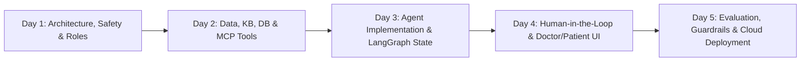

# Master Roadmap & Implementation Plan
## Project: City Care Clinics - Multi-Agent AI Healthcare Assistant
**Client:** City Care Clinics (5 outpatient clinics in Lahore & Islamabad, 30 doctors, 6 specialties)  
**Target Delivery:** 5 Days (Capstone Portfolio Grade)  
**Stack Alignment:** LangGraph, Gemini API / Groq (Free Tier), ChromaDB, PostgreSQL (Supabase / Local), Streamlit UI, MCP Protocol, Presidio PII Guardrails.

---

## 1. High-Level 5-Day Strategy

### Risk Mitigation & "Zero-Crash" Strategy
1. **Isolated Module Development:** Never build the full graph before its individual nodes and tools are unit-tested.
2. **Mocking External APIs First:** Test agent logic with simulated tool responses before integrating live external databases or SMTP servers.
3. **Strict Typed State:** Use Pydantic and `typing.TypedDict` with runtime validation to guarantee that agent outputs conform to expected schemas.
4. **Fallback Handlers:** Every LLM call is wrapped with fallback chains (e.g., Groq Llama-3.3-70b $\rightarrow$ Gemini 1.5 Flash $\rightarrow$ Graceful Degraded Response).
5. **Human-in-the-Loop Safeguard:** LangGraph `interrupt()` checkpoints ensure dangerous or unverified medical actions can never run automatically.

---

## 2. Day-by-Day Milestone Breakdown

### Day 1: System Design, Agent Roles & Clinical Safety Guardrails
- **Task 1: Multi-Agent Architecture Research & System Blueprint**
  - Pattern trade-offs: Supervisor vs. Swarm vs. Hierarchical.
  - State management (Typed State, Message Reducers) & MCP protocol benefits.
  - Human-in-the-Loop (HITL) architecture (Doctor-in-the-loop).
  - End-to-end Mermaid architectural flow diagram.
- **Task 2: Agent Role Cards (8 Specialized Agents)**
  - Inputs, outputs, tools, hard boundaries ("Never do"), and handoff conditions.
- **Task 3: Patient Conversation Flows**
  - Fever/Cough, Chest Pain (Emergency 1122), Child Booking, Lab Reports, Rescheduling, Medication Inquiries, Follow-ups.
- **Task 4: Safety & Triage Policy (UrduLish)**
  - Red-flag detection, 3-tier triage (Emergency / Urgent / Routine), standard UrduLish escalations.
- **Task 5: Privacy, Compliance & Persona System Prompts**
  - Presidio PII anonymization, audit logs, empathetic UrduLish persona system prompts.

### Day 2: Synthetic Datasets, Knowledge Base, Database & MCP Tooling
- **Synthetic Data Generation:**
  - 500 Pakistani patients (Faker: Urdu/Pakistani names, CNIC, phone `+92-3xx`, Lahore/Islamabad addresses, history, allergies).
  - 30 Doctors across 6 specialties (General Medicine, Paediatrics, Gynaecology, Cardiology, Dermatology, ENT) across 5 branches.
  - 100 Pakistani medications (Paracetamol/Panadol, Augmentin, Arinac, Softin, Glucophage, etc.) with dosages and interactions.
  - 30 Synthetic Lab Reports (PDF / Image data: CBC, LFT, Lipid, HbA1c, etc.).
- **Storage & Retrieval Setup:**
  - PostgreSQL schema (FHIR-aligned: Patients, Encounters, Appointments, Prescriptions, Audit Logs).
  - ChromaDB vector store (Clinic policies, prep guidelines, symptom-to-specialty mapper).
- **MCP Servers & Vision OCR:**
  - Tool interfaces exposed via standard MCP schema.
  - Gemini Vision API (multimodal free tier) for lab report parsing.

### Day 3: LangGraph Core, Supervisor & Specialized Agents
- **Core LangGraph Graph:**
  - `AgentState` definition with short-term conversation memory and persistent patient context.
  - Supervisor router logic (Intent classification + safety interceptor).
- **Agent Nodes:**
  - Intake Agent (UrduLish symptom extraction).
  - Triage Agent (Emergency detector).
  - Scheduling Agent (Doctor matching + calendar slot booking).
  - Records & Lab Agent (FHIR queries + Vision report interpretation).
  - Clinical Summary Agent (SOAP notes generation).
  - Prescription Safety Agent (Drug-allergy & drug-drug interaction checker).
  - Follow-up Agent (Automated notifications & feedback loop).

### Day 4: Human-in-the-Loop, Notifications & Dual Web Portal
- **Human-in-the-Loop Checkpoints:**
  - LangGraph Memory Saver / Postgres Checkpointer.
  - Pending approval state for doctor prescription reviews.
- **Communication & Notifications:**
  - Gmail / Email notification service for appointment confirmations and doctor summary dispatches.
- **Interactive Dual Interface (Streamlit):**
  - **Patient WhatsApp-like Chat:** UrduLish conversational interface with emergency banner.
  - **Doctor / Clinic Staff Portal:** Pending approvals queue, full SOAP notes, patient records viewer, manual override controls.

### Day 5: Safety Red-Teaming, Automated Testing & Cloud Deployment
- **Safety Testing & Evaluation Suite:**
  - Pytest automated test suite testing red-flag escalation, drug-interaction halts, PII sanitization.
  - Boundary testing: prompt injection attempts, direct diagnosis attempts.
- **Containerization & Deployment:**
  - Multi-stage `Dockerfile` and `docker-compose.yml`.
  - Deployment configuration for Render (Web Service) + Supabase (PostgreSQL).
- **Documentation & Portfolio Handover:**
  - Complete README, architecture diagrams, demo walkthrough script, and client presentation slides.

---

## 3. Technology & Free-Tier Setup Strategy

| Component | Selected Technology | Free-Tier Plan & Limits | Fallback / Local Alternative |
| :--- | :--- | :--- | :--- |
| **LLM (Text)** | Groq (Llama 3.3 70B / 8B) & Gemini 1.5/2.0 Flash | Free 30 RPM (Groq) / Free 15 RPM (Gemini) | Local Ollama if offline |
| **Vision (Labs)** | Gemini 1.5 Flash (Vision) | Free 15 RPM, zero installation needed | Local Tesseract OCR / docTR |
| **Agent Framework** | LangGraph + LangChain Core | Open source, runs locally | Pure Python State Machine |
| **Tool Protocol** | MCP (Model Context Protocol) | Open source Python SDK | Direct Tool Bindings |
| **Database** | PostgreSQL | Supabase Free Tier (500MB) | Local SQLite / Postgres in Docker |
| **Vector DB** | ChromaDB | Open source, embedded local storage | In-memory Chroma |
| **UI** | Streamlit | Open source, zero frontend build overhead | Next.js / FastAPI |
| **PII Guardrail** | Microsoft Presidio | Open source local NLP model | Regex + Keyword Sanitizer |
| **Deployment** | Render + Docker | Render Free Web Service + Supabase | Local Docker Compose |
