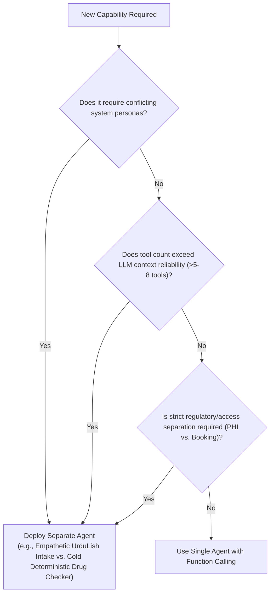
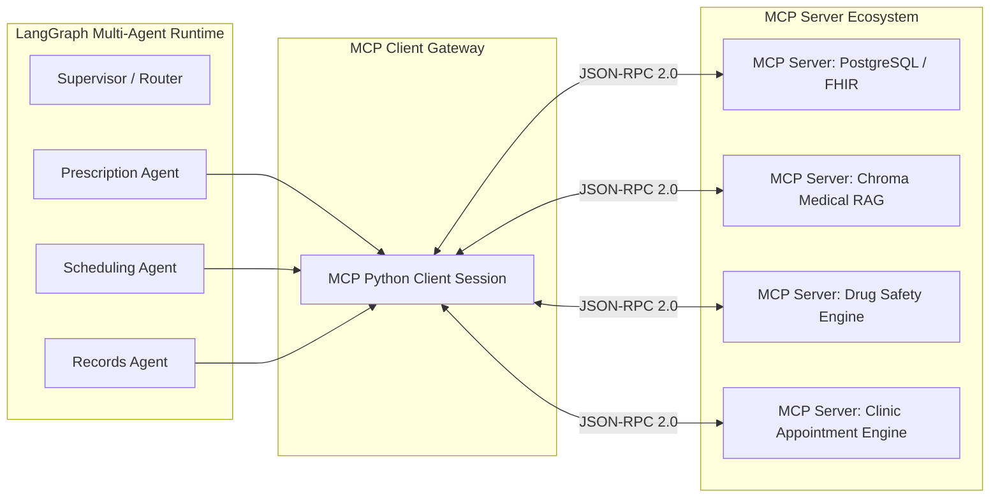
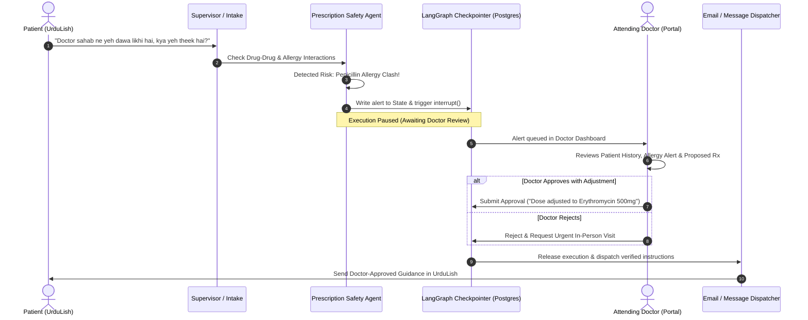
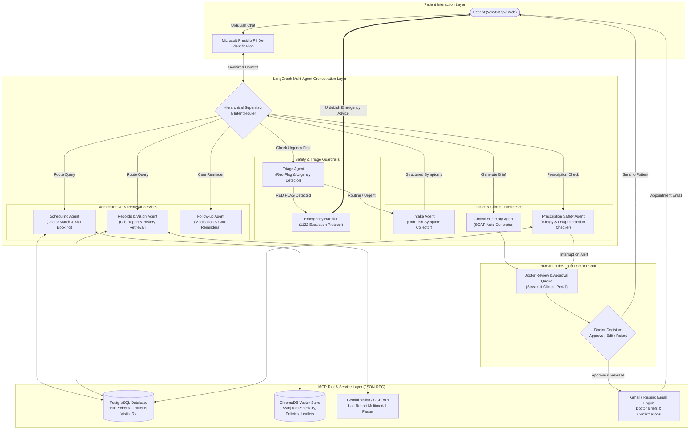

# Week 9 Capstone: City Care Clinics
# Day 1 — Task 1: Multi-Agent Architecture Research & System Blueprint

## Executive Summary
**City Care Clinics** operates 5 high-volume outpatient clinics in Lahore and Islamabad, staffed by 30 doctors across 6 clinical specialties. The clinic network faces acute reception bottlenecks, patient-specialist booking mismatches, unreviewed drug-allergy interactions, and unmonitored follow-ups.

This document details the multi-agent system architecture designed to solve these challenges using **LangGraph**, **Model Context Protocol (MCP)**, **PostgreSQL (FHIR-aligned)**, **ChromaDB**, and **Human-in-the-Loop (HITL)** medical guardrails.

---

## 1. Architectural Patterns: Supervisor vs. Swarm vs. Hierarchical

Selecting the right multi-agent coordination pattern is a safety-critical decision in healthcare.

| Dimension | Supervisor Pattern | Swarm (Peer-to-Peer) Pattern | Hierarchical Pattern (Recommended) |
| :--- | :--- | :--- | :--- |
| **Topology** | Central router directs traffic to/from worker agents. | Agents autonomously hand off to each other without central control. | Top-level Supervisor manages functional Domain Leads (Clinical, Admin, Safety). |
| **Control & Predictability** | High: Every transition passes through a deterministic or LLM router. | Low: Handoff loops can become nondeterministic or circular. | Maximum: Strict boundaries between triage, booking, and prescription safety. |
| **State Management** | Centralized `StateGraph` updated after each agent turn. | Fragmented state passed along handoff chains. | Scoped state partitions with unified clinical history checkpoints. |
| **Auditability & Compliance** | Easy: Single decision log tracks every routing choice. | Difficult: Distributed decision trail. | Flawless: HIPAA/FHIR-ready audit trail across administrative and clinical boundaries. |
| **Failure Mode** | Supervisor bottleneck if prompt is vague. | Runaway agent-to-agent loops, context dilution. | Graceful degradation: Fallback to emergency or human front desk. |

### Architectural Choice for City Care Clinics: **Hierarchical Supervisor Pattern**
In healthcare, a pure Swarm is dangerous: an Intake Agent must never directly transfer to a Prescription Safety Agent without urgent clinical triage occurring first. A single flat Supervisor can get overwhelmed by 8 distinct agent prompts and 20+ tool definitions.

Therefore, we implement a **Hierarchical Supervisor Architecture**:
1. **Root Supervisor / Clinical Router**: Sanitizes input (PII), evaluates urgency (Triage Interceptor), and routes to the appropriate functional agent.
2. **Administrative Cluster**: Scheduling Agent & Records Retrieval Agent.
3. **Clinical & Safety Cluster**: Intake Agent, Clinical Summary Agent, Prescription Safety Agent, Follow-up Agent.
4. **HITL Interceptor**: An immutable checkpoint gate before any clinical recommendation or prescription is finalized.

---

## 2. Decision Framework: When to Use One Agent vs. Many

A common anti-pattern in AI engineering is "over-agentification" (creating separate agents for tasks easily solved by a single prompt or function). Here is the empirical decision framework applied to City Care Clinics:



### Why City Care Clinics Requires 8 Distinct Agents:
1. **Persona & Cognitive Separation:**
   - The **Intake Agent** requires high empathy, warmth, and colloquial UrduLish fluency.
   - The **Prescription Safety Agent** requires zero colloquialism, zero creativity, high temperature=0 determinism, and strict adherence to pharmacological databases.
2. **Context Window Hygiene & Token Economics:**
   - Sending 30 doctor schedules, 100 drug interaction monographs, and past lab history in every prompt wastes tokens and causes catastrophic needle-in-a-haystack hallucination.
3. **Least Privilege & Role-Based Access Control (RBAC):**
   - The Scheduling Agent has write access to calendar slots but zero access to confidential lab diagnoses.
   - The Records Agent can read lab reports but cannot book appointments or issue notifications.

---

## 3. Shared State vs. Message Passing in LangGraph

LangGraph provides two core mechanisms for information flow:

### A. Message Passing (Pure Chat History)
- Agents append messages to a shared conversation log `List[BaseMessage]`.
- **Drawback in Clinical AI:** Unstructured text makes it hard to verify whether an allergy was collected, what triage score was assigned, or whether a doctor approved an action.

### B. Shared Typed State (`AgentState`) with Annotated Reducers (Our Implementation)
- We define a strongly-typed schema using Python's `TypedDict` and `pydantic`.
- Reducers (such as `operator.add` for message append and dictionary merge for clinical slots) allow agents to update isolated facets of the state without clobbering other data.

```python
from typing import TypedDict, Annotated, List, Optional, Dict, Any
from langchain_core.messages import BaseMessage
import operator

class PatientClinicalProfile(TypedDict):
    patient_id: Optional[str]
    name: Optional[str]
    age: Optional[int]
    gender: Optional[str]
    allergies: List[str]
    current_medications: List[str]
    chief_complaint: Optional[str]
    symptom_duration: Optional[str]
    urgency_level: Optional[str] # "EMERGENCY", "URGENT", "ROUTINE"

class ClinicAgentState(TypedDict):
    messages: Annotated[List[BaseMessage], operator.add]
    patient_profile: PatientClinicalProfile
    current_intent: Optional[str]
    matched_specialty: Optional[str]
    target_doctor_id: Optional[str]
    appointment_slot: Optional[Dict[str, Any]]
    soap_note: Optional[Dict[str, str]]
    prescription_alerts: List[Dict[str, Any]]
    requires_doctor_approval: bool
    doctor_approval_status: Optional[str] # "PENDING", "APPROVED", "REJECTED", "MODIFIED"
    audit_trail: Annotated[List[Dict[str, Any]], operator.add]
```

**Key Benefit:** When the Intake Agent learns that a patient is allergic to penicillin, it writes to `patient_profile.allergies`. When the Prescription Safety Agent executes later, it reads directly from this validated structured slot rather than re-parsing conversational UrduLish.

---

## 4. Model Context Protocol (MCP): Architecture & Strategic Value

### What is MCP?
The **Model Context Protocol (MCP)**, developed by Anthropic, is an open protocol that standardizes how applications expose tools, resources, and contextual prompts to LLMs via JSON-RPC 2.0 over standard I/O or Server-Sent Events (SSE).



### Why MCP is Vital for City Care Clinics:
1. **Security & Data Isolation:** LLM agents do not possess direct SQL credentials or database drivers. They communicate with an isolated MCP server process with strict parameter sanitization.
2. **Tool Reusability Across Models:** If City Care Clinics switches from Groq (Llama-3.3) to Gemini 2.0 Flash or Claude 3.5 Sonnet, zero tool integration code changes. The MCP server remains identical.
3. **Pluggable Architecture for 5 Clinic Branches:** Each physical clinic branch or laboratory partner can host their own standard MCP server without altering core LangGraph orchestration logic.

---

## 5. Human-in-the-Loop (HITL) Safety Architecture

### The Golden Medical Rule:
> **The AI must NEVER diagnose or prescribe medicine autonomously. It collects information, flags risks, and assists the doctor. Every medical recommendation or prescription verification MUST pass through human physician approval.**

LangGraph provides native stateful persistence (`MemorySaver` or `PostgresSaver`) that enables state suspension via `interrupt()`.



### Three HITL Interaction Modes Implemented:
1. **Interrupt & Approve:** Graph halts before booking confirmation or prescription validation. Doctor clicks "Approve".
2. **Interrupt & Edit:** Doctor modifies the dosage, medicine name, or clinical advice directly in the dashboard before releasing the message.
3. **Immediate Escalation Override:** If red flags are detected during intake (e.g., chest pain, infant fever > 103°F, stroke signs), the graph completely bypasses normal scheduling and immediately renders the Emergency 1122 protocol.

---

## 6. End-to-End System Architecture Diagram



---

## 7. Next Steps & Phase Alignment
With the multi-agent architecture and design rationale formalized:
- **Task 2:** We will define the detailed **Agent Role Cards** for all 8 agents (Goal, Inputs, Outputs, Tools, Never-Dos, and Handoff conditions).
- **Task 3:** Detail all **7 Patient Conversation Flows** including edge cases and UrduLish dialogues.
- **Task 4:** Codify the **Clinical Safety & Triage Policy**.
- **Task 5:** Establish the **Presidio PII configuration, audit logging schema, and empathetic UrduLish system prompts**.
