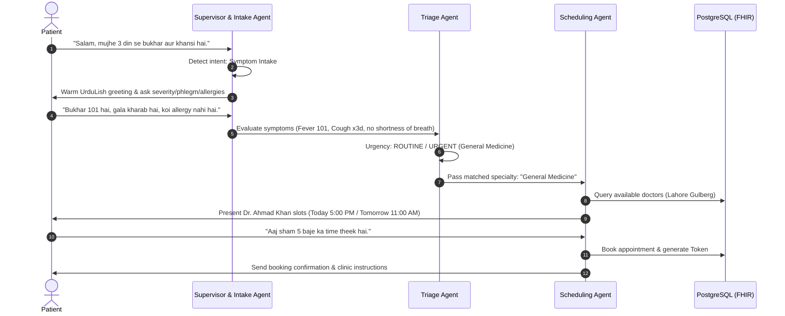
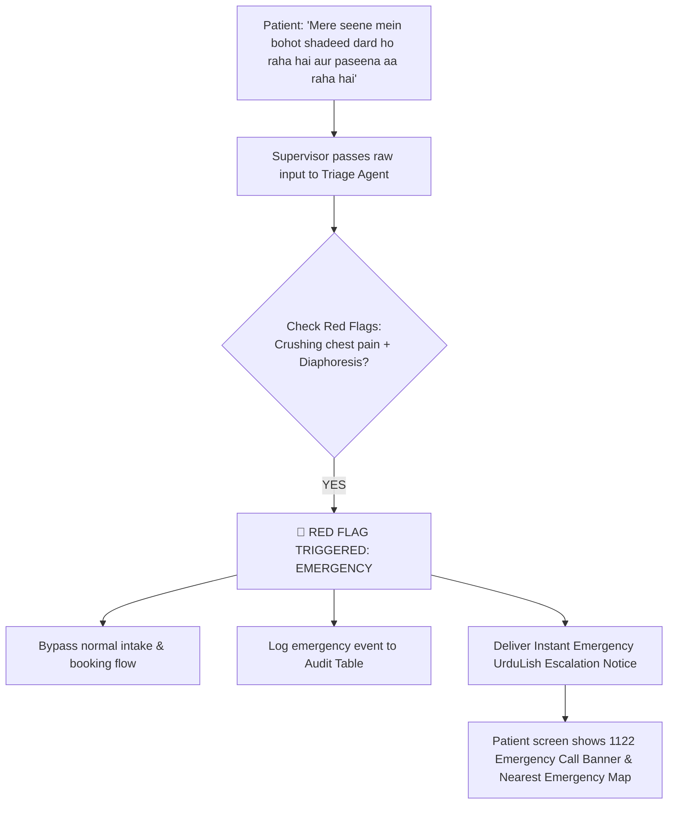
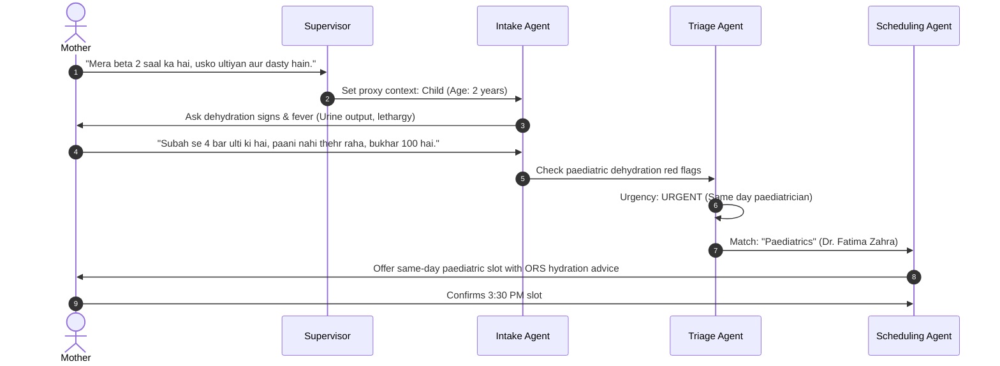
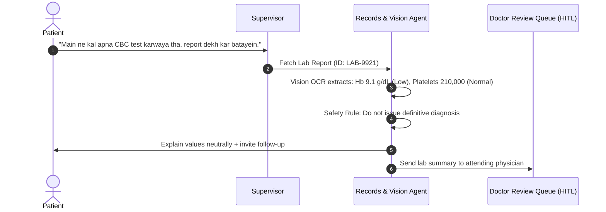
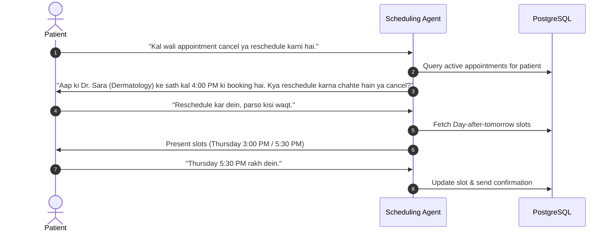
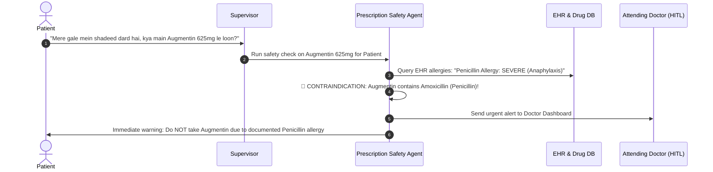
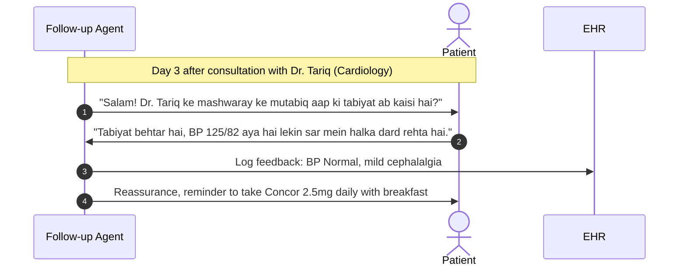

# Week 9 Capstone: City Care Clinics
# Day 1 — Task 3: Patient Conversation Flows & Scenarios

This document details all 7 mandatory patient interaction flows for City Care Clinics. Each flow contains a Mermaid flowchart, turn-by-turn conversational dialogue in authentic **UrduLish** (with English translations), background LangGraph state transitions, and MCP tool invocations.

---

## Overview of Conversation Flows

1. **Flow 1: Routine Intake & Booking** — New patient with fever and cough.
2. **Flow 2: Emergency Escalation** — Patient reporting acute chest pain (1122 protocol).
3. **Flow 3: Paediatric Proxy Booking** — Mother booking an appointment for a sick toddler.
4. **Flow 4: Lab Report Inquiry** — Returning patient asking about an uploaded CBC/HbA1c report.
5. **Flow 5: Appointment Modification** — Patient rescheduling or cancelling a confirmed slot.
6. **Flow 6: Medication Safety Inquiry** — Patient asking *"Kya main yeh dawai le sakta hoon?"* (Drug-allergy clash check).
7. **Flow 7: Post-Visit Adherence & Follow-up** — Automated medicine reminder and recovery check.

---

## Flow 1: New Patient with Fever and Cough (Routine / Urgent)

### Conversational Dialogue:
- **Patient:** "Assalam-o-Alaikum, mujhe 3 din se tez bukhar aur khansi hai. Doctor ko dikhana hai."  
  *(Hello, I have had high fever and cough for 3 days. I need to see a doctor.)*
- **Intake Agent:** "Wa Alaikum Assalam! City Care Clinics mein khush-amdeed. Main aap ki madad karta hoon. Yeh batayein ke bukhar kitna record kiya hai? Aur kya saans lene mein koi takleef ya seene mein dard mehsoos ho raha hai?"  
  *(Welcome to City Care Clinics. I am here to help. Could you tell me what temperature you recorded? Also, do you feel any chest pain or difficulty breathing?)*
- **Patient:** "Bukhar 101 tak gaya tha paracetamol lene ke baad kam ho jata hai. Saans mein koi takleef nahi hai, bas gala dard aur thakan hai."  
  *(Fever was up to 101, it goes down with paracetamol. No breathing trouble, just sore throat and fatigue.)*
- **Triage Agent (Internal):** Evaluated: Temperature 101°F, Duration 3 days, Red-flags absent $\rightarrow$ **Urgency: Routine / Same-Day Outpatient**. Specialty: **General Medicine**.
- **Scheduling Agent:** "Bohat shukriya tafseel batane ka. Hamare General Physician Dr. Ahmad Khan aaj sham City Care Clinics Gulberg branch mein dastyab hain:  
  1. Aaj Sham 5:00 PM  
  2. Aaj Sham 6:30 PM  
  Aap ko kon sa waqt munasib lagta hai?"  
  *(Thank you for the details. Our General Physician Dr. Ahmad Khan is available at our Gulberg branch today: 1. 5:00 PM 2. 6:30 PM. Which time suits you?)*
- **Patient:** "Sham 5:00 PM theek rahega."  
  *(5:00 PM will be fine.)*
- **Scheduling Agent:** "Aap ki appointment Dr. Ahmad Khan ke sath aaj sham 5:00 PM par Gulberg branch mein confirm ho chuki hai. Token #CC-104. Baraye meharbani waqt se 15 minute pehle tashreef layein. Allah aap ko sehat de!"  
  *(Your appointment is confirmed with Dr. Ahmad Khan at 5:00 PM today at Gulberg branch. Token #CC-104. Please arrive 15 minutes early. Wishing you good health!)*

---

## Flow 2: Patient with Chest Pain (Emergency 1122 Escalation)

### Conversational Dialogue:
- **Patient:** "Bhai mere seene mein achanak bohot shadeed dard aur dabao ho raha hai, bayen baazu mein dard ja raha hai aur paseena aa raha hai. Koi jaldi appointment mil sakti hai?"  
  *(Brother, I have sudden severe chest pain and pressure spreading to my left arm with cold sweats. Can I get an urgent appointment?)*
- **Triage Agent (Instant Emergency Intercept):**  
  > ⚠️ **EMERGENCY SAFETY ESCALATION TRIGGERED**  
  > **UrduLish Output:**  
  > **"⚠️ FORI EMERGENCY ALERTH:**  
  > Aap ki batai hui alamaat (seene ka dard, baazu mein phailna, aur paseena) nihayat sanjeeda aur dil ke doray (Heart Attack) ki nishani ho sakti hain.  
  > 
  > **Baraye meharbani appointment ka intizar hargiz na karein!**  
  > 1. **Foran Rescue 1122 par call karein** ya qareebi Emergency Hospital (maslan Punjab Institute of Cardiology / PIMS) tashreef le jayein.  
  > 2. Khud drive na karein, kisi ko sath le jayein.  
  > 3. Sukoon se baith jayein aur harkat kam se kam karein."  
  > *(Urgent Safety Notice: Your symptoms can indicate a critical cardiac emergency. Do not wait for a clinic appointment! Call 1122 immediately or go to the nearest emergency room. Do not drive yourself.)*

---

## Flow 3: Mother Booking for a Child (Paediatrics Proxy Flow)

### Conversational Dialogue:
- **Mother:** "Mera 2 saal ka beta hai, subah se lagatar ultiyan aur dast kar raha hai. Kuch kha pee nahi raha."  
  *(I have a 2-year-old son, he has had continuous vomiting and diarrhoea since morning. He cannot keep food or fluids down.)*
- **Intake Agent:** "Bachay ki tabiyat ke bare mein sun kar afsos hua. Hum foran paediatric specialist ka intazam karte hain. Yeh batayein ke kya bacha bohat zyada ghunooda (drowsy) ho raha hai? Aur aakhri dafa peshab kab kiya tha?"  
  *(Sorry to hear about your child. We will arrange a paediatric specialist right away. Has he become excessively drowsy? And when was his last urination?)*
- **Mother:** "Nahi drowsy nahi hai ro raha hai, peshab 2 ghante pehle kiya tha. Bas kamzor lag raha hai."  
  *(He is not drowsy, he is crying, last urinated 2 hours ago. He just looks weak.)*
- **Triage Agent (Internal):** Evaluated: 2-year-old, vomiting x 4, urine output maintained within 2 hours $\rightarrow$ **Urgent Same-Day Paediatric Care** (not in hypovolemic shock yet, but requires urgent rehydration assessment).
- **Scheduling Agent:** "Hum ne Dr. Fatima Zahra (Consultant Paediatrician) ke sath aaj dopehar 3:30 PM par City Care DHA Branch mein slot reserve kiya hai.  
  **Ahem hidayat:** Doctor ke paas pohnchne tak thori thori miqdaar mein chammach ke sath ORS (Nimkol) pilati rahein. Kya 3:30 PM confirm kar doon?"  
  *(We have reserved a slot with Dr. Fatima Zahra at 3:30 PM today at DHA Branch. Vital note: Keep giving small sips of ORS until you arrive. Shall I confirm 3:30 PM?)*
- **Mother:** "Jee bilkul confirm kar dein."  
  *(Yes, please confirm.)*

---

## Flow 4: Returning Patient Asking About a Lab Report

### Conversational Dialogue:
- **Patient:** "Main City Care Gulberg se kal blood test karwaya tha. Mere platelets aur haemoglobin ka kya result aya hai? Kya koi bimari hai?"  
  *(I had a blood test at City Care Gulberg yesterday. What is my platelets and haemoglobin result? Do I have a disease?)*
- **Records Agent:** "Assalam-o-Alaikum! Main aap ki CBC report verify kar raha hoon...  
  Aap ki report ke mutabiq:  
  - **Platelets:** 210,000 /mcL (Yeh normal range 150,000 - 450,000 ke andar hain).  
  - **Haemoglobin (Hb):** 9.1 g/dL (Yeh standard range 12.0 - 15.5 se thora kam hai).  
  
  **Tawajjah farmayein:** Yeh sirf lab test ki tadaad hai. Is ki asal wajah (jaise iron ki kami) sirf doctor sahab aap ki mukammal physical examination ke baad tay karein ge. Kya main Dr. Ahmad Khan ke sath aap ka follow-up consult schedule kar doon?"  
  *(Hello! I am retrieving your CBC report. Your platelets are normal at 210k. Your Haemoglobin is 9.1 g/dL, which is below the standard range. Please note: This is only a numerical value. The exact clinical reason like iron deficiency can only be diagnosed by the doctor after physical examination. Shall I schedule your follow-up consultation?)*

---

## Flow 5: Reschedule or Cancel Appointment

### Conversational Dialogue:
- **Patient:** "Salam, kal sham Dr. Sara Malik ke sath meri skin wali appointment thi. Kisi zaroori kaam ki wajah se main kal nahi aa sakta, kya parso ka time mil sakta hai?"  
  *(Hello, I had an appointment with Dr. Sara Malik tomorrow evening. Due to urgent work I cannot make it, can I move it to the day after tomorrow?)*
- **Scheduling Agent:** "Wa Alaikum Assalam! Koi masla nahi. Main ne aap ki kal wali booking (Token #CC-82, Dr. Sara Malik - Dermatology) check kar li hai.  
  Parso (Jumerat) ko Dr. Sara ke paas yeh do timings dastyab hain:  
  1. Dopehar 3:00 PM  
  2. Sham 5:30 PM  
  Aap in mein se kon sa waqt pasand karein ge?"  
  *(No problem! I have found your booking Token #CC-82 for Dr. Sara Malik. The day after tomorrow (Thursday), Dr. Sara has two available slots: 1. 3:00 PM 2. 5:30 PM. Which would you prefer?)*
- **Patient:** "Thursday sham 5:30 PM theek hai."  
  *(Thursday 5:30 PM is good.)*
- **Scheduling Agent:** "Aap ki appointment successfully reschedule ho chuki hai! Nayi timing: **Jumerat, Sham 5:30 PM (City Care F-8 Islamabad)**. Purani booking cancel kar di gayi hai. Confirmation email aur message bhej diya gaya hai."  
  *(Your appointment has been successfully rescheduled to Thursday 5:30 PM at F-8 Islamabad branch. Old slot released. Confirmation sent.)*

---

## Flow 6: Patient Asking *"Kya main yeh dawai le sakta hoon?"* (Safety & Allergy Check)

### Conversational Dialogue:
- **Patient:** "Assalam-o-Alaikum, mere gale mein shadeed infection aur dard hai. Ghar mein Augmentin 625mg ki goli pari hai, kya main yeh kha sakta hoon?"  
  *(Hello, I have a severe throat infection and pain. I have an Augmentin 625mg tablet at home, can I take it?)*
- **Prescription Safety Agent (Immediate Safety Interception):**  
  > 🛑 **SAFETY ALERT: ALLERGY CONTRAINDICATION DETECTED**  
  > **UrduLish Output:**  
  > **"Hargiz nahi! Yeh dawai bilkul mat khayein!**  
  > Aap ke clinical record ke mutabiq aap ko **Penicillin group se shadeed allergy** hai. Augmentin mein Amoxicillin (Penicillin) shaamil hota hai, jis se aap ko saans band hone ya jism par shadeed allergy ka khatra ho sakta hai.  
  > 
  > Hum ne yeh alert foran hamare duty doctor ko forward kar diya hai. Gale ke infection ke liye doctor sahab aap ki allergy ko madde-nazar rakhte huwe mehfooz badal (alternative antibiotic) tajweez karein ge. Baraye meharbani khud se koi antibiotic shuru na karein."  
  > *(Under no circumstances should you take this medicine! According to your clinical records, you have a severe Penicillin allergy. Augmentin contains Penicillin which can cause severe reactions or breathing difficulty. We have alerted the duty doctor to prescribe a safe alternative. Do not self-medicate with antibiotics.)*

---

## Flow 7: Post-Visit Adherence & Follow-Up Check

### Conversational Dialogue:
- **Follow-up Agent (Automated Outreach):**  
  "Assalam-o-Alaikum Janab! City Care Clinics ki janib se umeed hai aap khairiyat se hon ge. 3 din qabal aap Dr. Tariq (Cardiology) ke paas tashreef laye thay.  
  Ab aap ki tabiyat kaisi hai? Kya aap ne blood pressure check kiya hai?"  
  *(Hello! Greetings from City Care Clinics. You visited Dr. Tariq 3 days ago. How are you feeling now? Have you checked your blood pressure?)*
- **Patient:** "Walaikum Assalam, ji BP check kiya tha 125/82 aya hai jo pehle se kaafi behtar hai. Dawa waqt par le raha hoon."  
  *(Hello, yes I checked, BP was 125/82 which is much better than before. I am taking medicine on time.)*
- **Follow-up Agent:** "Alhamdulillah, yeh bohat achi khabar hai ke aap ka blood pressure behtar ho raha hai!  
  Baraye meharbani apni subah ki dawai nashtay ke baad pabandi se jari rakhein. Agar sar dard ya chakkar ki shikayat ho to foran hamein aagah karein. Agla follow-up visit 2 hafte baad tay hai. Allah aap ko kamil sehat atta farmaye!"  
  *(Praise be to God, that is wonderful news! Please continue taking your morning medicine with breakfast. If you feel any dizziness or headaches let us know immediately. Next follow-up is scheduled in 2 weeks.)*
