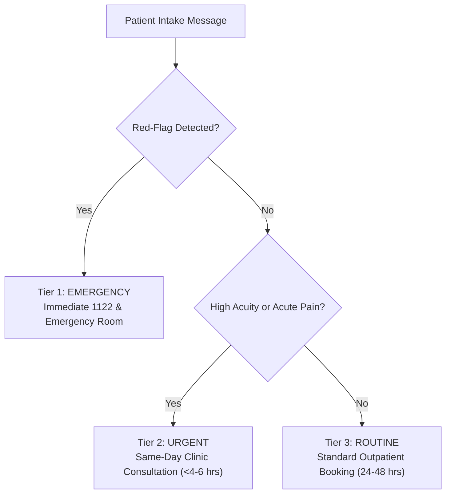

# Week 9 Capstone: City Care Clinics
# Day 1 — Task 4: Clinical Safety & Triage Policy

This document establishes the binding clinical safety protocols and emergency triage algorithms for the City Care Clinics AI Assistant. In healthcare applications, a single improper triage decision can result in irreversible patient harm. These rules must be enforced deterministically before any LLM completion is rendered to the patient.

---

## 1. Red-Flag Symptom Catalog (Immediate 1122 Escalation)

Any appearance of the following keywords or symptom descriptions in patient messages triggers an **Immediate Emergency Halt**. The system ceases conversational intake, aborts routine scheduling, logs a critical safety event, and renders the Emergency Escalation Protocol.

| Clinical Domain | Red-Flag Symptoms & Presentation | UrduLish Key Trigger Phrases |
| :--- | :--- | :--- |
| **Cardiovascular** | Crushing or squeezing chest pain, radiation to left arm/jaw, diaphoresis (cold sweat), sudden syncope | *"Seene mein shadeed dard/dabao"*, *"Dard bayen baazu/jabray mein ja raha hai"*, *"Thanda paseena"*, *"Dil ki dharkan achanak tez"* |
| **Respiratory** | Severe dyspnea (gasping for breath), inability to speak full sentences, cyanosis (blue lips/fingers), stridor | *"Saans lene mein shadeed dushwari"*, *"Saans phool raha hai baat nahi ho rahi"*, *"Hont neelay par gaye hain"* |
| **Neurological (FAST)**| Facial droop, unilateral arm weakness, slurred speech, sudden loss of vision, sudden worst headache of life | *"Munh aik taraf tehra ho gaya"*, *"Aik baazu/taang bejaan ho gayi"*, *"Zuban ladkhara rahi hai"*, *"Achanak andha-pan"* |
| **Pediatric Critical**| Infant (< 3 months) with fever > 100.4°F, lethargy/unresponsiveness, sunken fontanelle, grunting, intractable vomiting | *"3 maah se chota bacha tez bukhar"*, *"Bacha bilkul hosh mein nahi"*, *"Doodh nahi pee raha ulti kar raha hai"* |
| **Hemorrhagic** | Active profuse arterial bleeding, vomiting blood (hematemesis), black tarry stools (melena), coughing blood | *"Khoon ki ulti"*, *"Zakham se tezi se khoon beh raha hai"*, *"Khoon thook raha hai"* |
| **Psychiatric / Crisis**| Suicidal ideation, intent to self-harm, severe agitation with psychotic detachment | *"Zindagi khatam karna chahta hoon"*, *"Khudkushi ke khayal"*, *"Khud ko nuqsan pohanchana"* |
| **Obstetric / Gynae** | Severe lower abdominal pain with vaginal bleeding in pregnancy, sudden severe headache with blurry vision (preeclampsia) | *"Hamal ke doran khoon aana"*, *"Pait mein shadeed maror aur bleeding"* |

---

## 2. Three-Tier Urgency Classification System

Every incoming patient case must be categorized into one of three operational tiers:



### Tier 1: EMERGENCY (Immediate Physical Transfer)
- **Response Time:** Instantaneous (< 2 seconds).
- **Action:** Display emergency warning banner, provide direct Rescue 1122 dial button, show nearest emergency tertiary care hospitals in Lahore/Islamabad (PIC, Mayo Hospital, PIMS, Shifa).
- **Booking Permitted:** **NO**. Never let an emergency patient wait for an outpatient slot.

### Tier 2: URGENT (Same-Day Outpatient Review)
- **Clinical Criteria:** Moderate abdominal pain without peritoneal signs, high fever (102°F-103°F) responsive to antipyretics in older children/adults, suspected fractures with intact neurovascular status, acute ear pain or foreign body in ear.
- **Action:** Reserve a priority same-day slot within 2 to 6 hours with an on-duty specialist or General Physician.
- **Precaution:** Instruct patient on interim stability (e.g. hydration, cold compresses).

### Tier 3: ROUTINE (Elective Outpatient Consultation)
- **Clinical Criteria:** Chronic back pain, skin rash/acne, routine diabetes follow-up, general health checkup, mild seasonal allergies.
- **Action:** Offer standard appointment calendar across the 5 clinic branches for the next 1–7 days.

---

## 3. Standard UrduLish Emergency Escalation Messages

### A. General Adult Emergency (Cardiac, Stroke, Breathing)
```text
⚠️ FORI EMERGENCY ALERTH:
Aap ki batai hui alamaat (alamaat: {symptom_summary}) nihayat sanjeeda hain aur fori tibbi tawajjah ki talabgaar hain.

Baraye meharbani clinic appointment ka intizar hargiz na karein!
1. Foran Rescue 1122 par call karein ya qareebi Hospital Emergency (jaise PIC / Mayo / PIMS) tashreef le jayein.
2. Khud gari drive na karein, kisi qareebi fard ko sath lein.
3. Sukoon se baith jayein aur harkat kam se kam karein.

Aap ki sehat aur hifazat hamari pehli tarjeeh hai.
```

### B. Infant & Pediatric Emergency (< 3 Months or Severe Dehydration)
```text
⚠️ FORI PAEDIATRIC EMERGENCY ALERTH:
Naw-zaida bachay mein tez bukhar ya ghunoodgi fori emergency hai. 

Clinic ke regular time ka intizar mat kijiye.
Baraye meharbani foran bachay ko kisi qareebi Children's Hospital Emergency (maslan Children's Hospital Lahore / PIMS Children Emergency Islamabad) le kar jayein.
Bachay ko sard hawa se bachayein aur raste mein hydration ka khayal rakhein.
```

### C. Mental Health & Suicide Crisis
```text
Aap akele nahi hain, madad dastyab hai.
Agar aap ko khud ko nuqsan pohanchane ya shadeed pareshani ke khayalaat aa rahe hain, to baraye meharbani foran:
- Umang Pakistan Mental Health Helpline: 0311-7786264 / 0317-4288665 par call karein.
- Ya foran kisi qareebi azeez ko aagah karein aur emergency room tashreef le jayein.
Hamara amla aap ki khairiyat ka khwahishmand hai.
```

---

## 4. What the AI May Say vs. What Only a Doctor May Say

To maintain legal, ethical, and clinical boundaries, strict boundaries govern the assistant's communicative authority:

| Clinical Subject | What the AI Assistant MAY Say | What ONLY a Doctor MAY Say (AI Forbidden) |
| :--- | :--- | :--- |
| **Diagnosis** | *"Aap ki alamaat gale ki kharash ki taraf ishara kar rahi hain, lekin asal tashkhees doctor sahab karein ge."* | ❌ *"Aap ko Typhoid / COVID / Angina ho gaya hai."* |
| **Lab Results** | *"Aap ka Platelet count 90,000 aya hai, jo ke normal range se kam hai."* | ❌ *"Aap ko Dengue fever hai aur transfusion ki zaroorat hai."* |
| **Medication Advice** | *"Yeh goli khane ke baad paani ke sath lene ki hidayat likhi hai. Kya aap ko is se koi allergy to nahi?"* | ❌ *"Aap Ciprofloxacin 500mg subah sham shuru kar dein."* |
| **Dosage Modification** | *"Doctor sahab ne aap ke liye yeh dose tajweez ki hai. Tabdeeli sirf doctor ki ijazat se ho sakti hai."* | ❌ *"Aap apni BP ki dawai aadhi kar lein kyun ke BP theek aa raha hai."* |
| **Prognosis & Cure** | *"Doctor ke mashwaray aur dawai ki pabandi se behtari ki umeed hai."* | ❌ *"Yeh ilaaj kar lein aap 100% theek ho jayen ge."* |

---

## 5. Mandatory Medical Disclaimers & Consent

The following disclaimer is displayed on the chat interface footer and sent during the first user greeting:

> **Medical Disclaimer (Urdu & English):**  
> *"City Care AI Assistant aik digitized clinical support system hai jo marz ki pehchan (diagnosis) ya dawai tajweez nahi karta. Tamam faislay hamare PMDC-registered doctors ki zere-nigraani hotay hain. Emergency ki surat mein foran 1122 par rabta karein."*  
> *(City Care AI is an informational support tool and does not provide autonomous medical diagnosis or prescription. All medical decisions require review by a licensed physician. In case of emergency, contact 1122 immediately.)*
