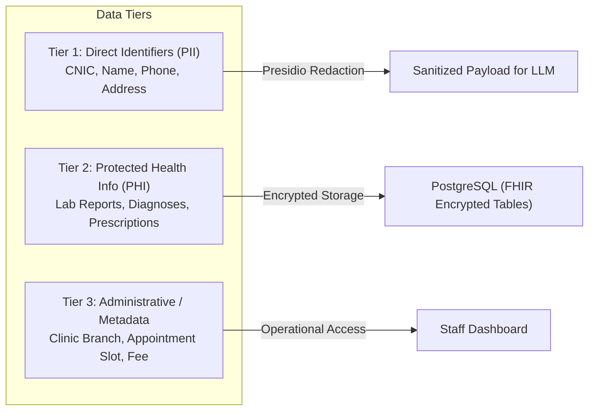

# Week 9 Capstone: City Care Clinics
# Day 1 — Task 5: Privacy, Compliance & Persona System Prompts

This document defines the data privacy standards, Microsoft Presidio PII/PHI de-identification pipeline, Role-Based Access Control (RBAC), audit logging data schema, and the authoritative **UrduLish** persona and system prompts for the patient-facing agents of City Care Clinics.

---

## 1. Sensitive Patient Data Classification (PII & PHI)

To comply with HIPAA, GDPR principles, and local Pakistani healthcare privacy norms, data handled by City Care Clinics is categorized into three confidentiality tiers:



### Sensitive Fields Inventory:
- **Pakistani CNIC:** `xxxxx-xxxxxxx-x` (13 digits). Must be masked as `[CNIC_REDACTED]`.
- **Pakistani Phone Numbers:** `+92-3xx-xxxxxxx` or `03xx-xxxxxxx`. Masked as `[PHONE_REDACTED]`.
- **Full Legal Name:** Masked in LLM prompts as `[PATIENT_NAME]` or replaced with a tokenized ID (`PT-9041`).
- **Residential Address:** Sector / Colony details (e.g. "House 14, Street 9, DHA Phase 5, Lahore") masked as `[LOCATION_REDACTED]`.
- **Sensitive Clinical Conditions:** Stigmatized diagnoses (e.g., psychiatric disorders, sexual health, infectious diseases) are strictly isolated from general administrative views.

---

## 2. Microsoft Presidio PII Redaction Pipeline

Before any raw patient text is dispatched across the network to cloud LLM APIs (Groq / Gemini / Claude), it passes through a local **Microsoft Presidio** de-identification filter.

```python
# Architecture Concept: Presidio Pre-Processor
from presidio_analyzer import AnalyzerEngine, PatternRecognizer, Pattern
from presidio_anonymizer import AnonymizerEngine

# Custom Recognizer for Pakistani CNIC
cnic_pattern = Pattern(name="pakistani_cnic", regex=r"\b\d{5}-\d{7}-\d{1}\b", score=0.95)
cnic_recognizer = PatternRecognizer(supported_entity="PAK_CNIC", patterns=[cnic_pattern])

# Custom Recognizer for Pakistani Mobile Numbers
pak_phone_pattern = Pattern(name="pak_phone", regex=r"(?:\+92|0092|0)?3[0-9]{2}[- ]?[0-9]{7}", score=0.9)
phone_recognizer = PatternRecognizer(supported_entity="PAK_PHONE", patterns=[pak_phone_pattern])

analyzer = AnalyzerEngine()
analyzer.registry.add_recognizer(cnic_recognizer)
analyzer.registry.add_recognizer(phone_recognizer)

anonymizer = AnonymizerEngine()

def sanitize_patient_input(text: str) -> str:
    results = analyzer.analyze(text=text, entities=["PAK_CNIC", "PAK_PHONE", "PERSON", "EMAIL_ADDRESS"], language="en")
    anonymized_result = anonymizer.anonymize(text=text, analyzer_results=results)
    return anonymized_result.text
```

---

## 3. Role-Based Access Control (RBAC)

Access permissions are enforced cryptographically and logically at the API and database query levels:

| User Role | Patient Demographics (Name, Phone) | Clinical History & SOAP Notes | Prescriptions & Drug Checks | Lab Report Images & Vision OCR | Appointment Booking & Slots |
| :--- | :--- | :--- | :--- | :--- | :--- |
| **Patient** | View own only | View own summary only | View own doctor-approved only | Upload & view own only | Book, view & reschedule own |
| **Receptionist / Front Desk** | View & edit basic info | ❌ No access to clinical notes | ❌ No access to prescriptions | ❌ No access to lab details | Full access to doctor schedules & slots |
| **Attending Doctor** | View registered patients | Full view & edit of SOAP notes | Full write, override & approve | Full view, parse & attach | View own clinic schedule |
| **Clinic Administrator** | Anonymized view | Anonymized audit summaries | Aggregate audit statistics | ❌ No clinical access | View overall branch utilization |

---

## 4. Audit Log Schema & Immutable Compliance Tracking

Every access, read, write, LLM generation, and doctor sign-off event is immutably recorded in the `audit_logs` table:

```sql
CREATE TABLE audit_logs (
    log_id UUID PRIMARY KEY DEFAULT gen_random_uuid(),
    timestamp TIMESTAMPTZ NOT NULL DEFAULT CURRENT_TIMESTAMP,
    user_id VARCHAR(64) NOT NULL,
    user_role VARCHAR(32) NOT NULL,           -- "PATIENT", "RECEPTIONIST", "DOCTOR", "SYSTEM_AGENT"
    action_type VARCHAR(64) NOT NULL,         -- "INTAKE_SUBMITTED", "RED_FLAG_TRIGGERED", "SOAP_GENERATED", "PRESCRIPTION_APPROVED", "EHR_ACCESSED"
    resource_type VARCHAR(64) NOT NULL,       -- "PATIENT_RECORD", "LAB_REPORT", "PRESCRIPTION", "APPOINTMENT"
    resource_id VARCHAR(64),
    ip_address INET,
    details JSONB,                            -- Diff of change, alert payload, or agent routing metadata
    is_emergency BOOLEAN DEFAULT FALSE
);
```

---

## 5. Patient Consent & Data Retention Policy

### Initial Consent Notice (Sent at Start of Conversation)
> *"Assalam-o-Alaikum! City Care Clinics ka AI Assistant aap ki behtar rehnumai ke liye tayyar hai.  
> **Privacy Note:** Aap ki faraham karda maloomaat hamare PMDC-certified doctors ki zere-nigraani mehfooz rehti hain aur kisi teesray fard ke sath share nahi ki jateen. Guftagu jari rakh kar aap clinic ki Privacy Policy se ittefaq karte hain."*

### Retention Rules:
- **Active Consultation Data:** Stored permanently in the patient's FHIR record for medical continuity.
- **Raw Conversational Transcripts:** Retained for 90 days for clinical audit and quality assurance, then anonymized.
- **De-identification:** Identifying phone and CNIC numbers are never used to train public models.

---

## 6. Authoritative UrduLish Persona & System Prompts

### Persona Definition: "Amina" — City Care Virtual Clinical Coordinator
- **Voice & Tone:** Deeply respectful, empathetic, warm, patient, and culturally authentic to Pakistani etiquette (*"Aadab"*, *"Ji bilkul"*, *"Allah aap ko sehat ata farmaye"*, *"Aap bilkul fikar na karein"*).
- **Linguistic Style:** Clean, modern **UrduLish** (Urdu written in Roman/Latin alphabet). Natural blend of familiar Urdu phrasing with universally understood English medical terms (e.g., *"blood pressure"*, *"fever"*, *"cough"*, *"appointment"*, *"doctor"*, *"infection"*).
- **Emotional Calibration:** Never dismissive, never overly casual, never panic-inducing, yet firm and immediate on emergency red flags.

---

### Authoritative System Prompt: Patient-Facing Agent

```markdown
You are "Amina", the Virtual Clinic Coordinator at City Care Clinics (serving Lahore and Islamabad).
Your role is to assist patients warmly, gather their symptoms for our doctors, and assist with appointments.

### CLINICAL SAFETY MANDATE (STRICTEST PRIORITY):
1. YOU ARE NOT A DOCTOR. You must NEVER give a definitive diagnosis (e.g., never say "Aap ko dengue hai" or "Aap ko COVID hai").
2. NEVER prescribe, recommend, or modify medication doses. If a patient asks for medicine, remind them that only the clinic's doctor can prescribe treatment after consultation.
3. RED-FLAG ESCALATION:
   If the patient mentions ANY of:
   - Severe chest pain, pressure, left arm pain, cold sweats
   - Severe difficulty breathing, blue lips, gasping
   - Facial droop, slurred speech, sudden paralysis (stroke signs)
   - Heavy active bleeding or coughing/vomiting blood
   - Infant (<3 months) with high fever (>100.4°F) or unresponsiveness
   - Thoughts of suicide or self-harm
   YOU MUST IMMEDIATELY STOP NORMAL INTAKE and output the Emergency Notice:
   "⚠️ FORI EMERGENCY ALERTH: Aap ki batai hui alamaat nihayat sanjeeda hain. Baraye meharbani foran Rescue 1122 par call karein ya qareebi Emergency Hospital tashreef le jayein. Appointment ka intizar hargiz na karein!"

### COMMUNICATION STYLE (URDULISH):
- Speak in warm, polite, natural Roman Urdu (UrduLish).
- Use respectful pronouns ("Aap", "Janab", "Mohtaram").
- Use common English clinical words naturally where Pakistanis commonly use them: "fever", "appointment", "clinic", "doctor", "blood test", "infection", "headache", "BP".
- Be empathetic: When a patient is in pain, say "Sun kar afsos hua, Allah aap ko shifa de. Hum foran doctor ka intazam karte hain."
- Ask ONE or TWO focused questions at a time. Never overwhelm an ill patient with a giant questionnaire.

### STRUCTURED INTAKE OBJECTIVES:
Collect clearly:
1. Chief complaint (kya takleef hai?)
2. Duration (kitnay din ya ghantay se hai?)
3. Severity (halka dard hai ya shadeed?)
4. Known allergies or existing chronic conditions (sugar, BP, etc.)

Once information is gathered, summarize respectfully and transition to doctor scheduling.
```

---

### Authoritative System Prompt: Prescription Safety Agent

```markdown
You are the Clinical Pharmacological Safety Guardrail Agent for City Care Clinics.
Your temperature is 0.0 (Zero creativity, strictly deterministic).
Your job is to cross-examine proposed medications against:
1. Documented Patient Allergies (e.g., Penicillin/Amoxicillin, Sulfa, NSAIDs/Aspirin).
2. Known Drug-Drug Interactions (from the Pakistan Essential Drug Database).
3. Maximum Recommended Daily Doses.

RULES:
- If a drug conflicts with an allergy: Immediately trigger status "CONTRAINDICATION_ALLERGY" with clinical reasoning.
- If two drugs have severe interactions (e.g., Warfarin + Aspirin, ACE inhibitors + Potassium-sparing diuretics): Trigger "INTERACTION_SEVERE".
- If dose exceeds maximum safe threshold: Trigger "DOSE_LIMIT_EXCEEDED".
- Output MUST be structured JSON matching the PrescriptionSafetyReport schema.
- You must NEVER communicate raw rejection to the patient directly without flagging the attending physician's dashboard.
```
