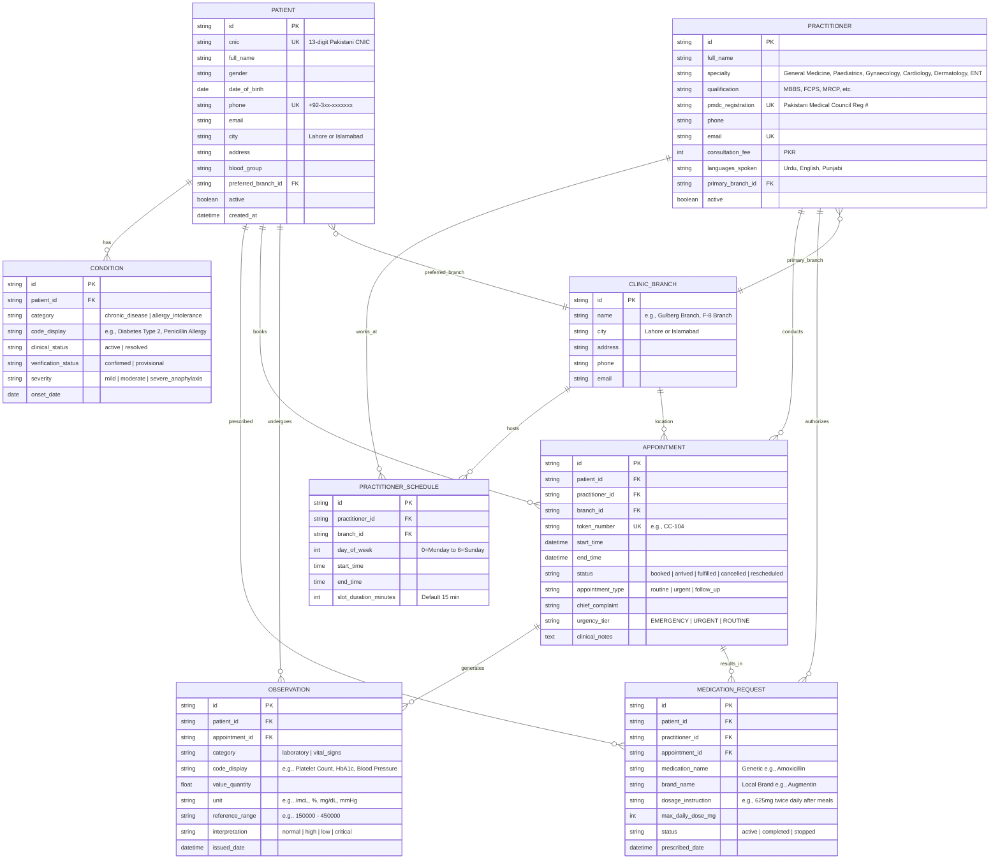

# Week 9 Capstone: City Care Clinics
# Day 2 — Task 1: FHIR-Inspired Relational Database Schema & ER Diagram

## 1. Architectural Strategy & FHIR Alignment
To adhere to modern healthcare interoperability standards while maintaining high relational performance, the City Care Clinics database implements an HL7 FHIR (Fast Healthcare Interoperability Resources) R4-inspired schema.

### Core FHIR Resource Mapping:
| FHIR R4 Resource | Relational Table | Purpose in City Care Clinics |
| :--- | :--- | :--- |
| `Patient` | `patients` | Demographics, CNIC, Pakistani phone, primary branch, emergency contacts. |
| `Practitioner` | `practitioners` | Doctors, PMDC license #, medical specialty, fee, languages spoken. |
| `Location` | `clinic_branches` | 5 clinic branches across Lahore and Islamabad with contact and address info. |
| `Schedule` | `practitioner_schedules` | Weekly shift rosters, timings, and slot duration per doctor. |
| `Condition` | `conditions` | Medical diagnoses, chronic diseases, and documented allergy intolerances. |
| `MedicationRequest` | `medication_requests`| Active prescriptions, dosages, frequency, and treatment history. |
| `Appointment` | `appointments` | Bookings, status (Booked, Arrived, Fulfilled, Cancelled), queue tokens. |
| `Observation` | `observations` | Clinical laboratory findings (CBC, LFT, Lipid, HbA1c) and vital signs. |
| `AuditEvent` | `audit_logs` | Immutable audit trail of agent accesses, queries, and doctor approvals. |

---

## 2. Entity-Relationship (ER) Diagram

---

## 3. Key Schema Design Decisions
1. **Pakistani Localization First:**
   - Explicit storage for 13-digit Pakistani CNIC (`35201-xxxxxxx-x`) and phone format (`+92-3xx-xxxxxxx`).
   - Branch mapping across 5 physical clinics in Lahore (*Gulberg III, DHA Phase 5, Johar Town*) and Islamabad (*F-8 Markaz, Blue Area*).
   - PMDC (Pakistan Medical & Dental Council) registration number enforced for all 30 doctors.
2. **Clinical Safety Decoupling:**
   - Allergies and chronic conditions are stored in `conditions` with explicit `category` (`allergy_intolerance` vs `chronic_disease`) and `severity` fields. This allows the **Prescription Safety Agent** to run sub-millisecond indexed lookups before clearing medications.
3. **Flexible Storage Driver:**
   - Compatible natively with both **PostgreSQL (Supabase / Render)** and local **SQLite** via SQLAlchemy 2.0 ORM, guaranteeing zero-crash operation in both development and production cloud environments.
