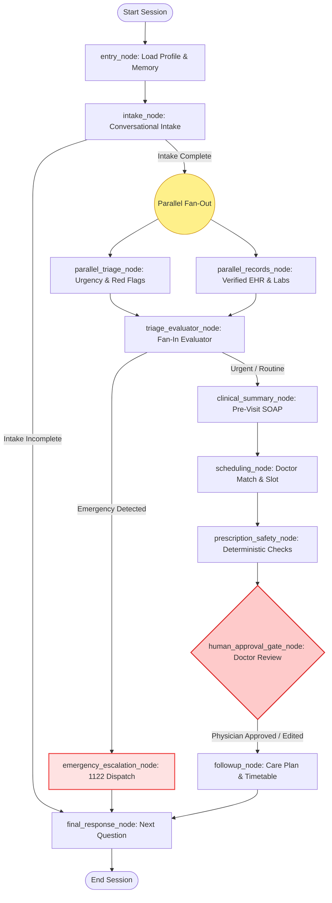

# Week 9 — Day 4: Orchestration, Memory & Human-in-the-Loop Architecture Report

**Organization:** City Care Clinics (Private Hospital Network, Pakistan)  
**System:** Multi-Agent AI Healthcare Orchestration & Clinical Governance System  
**Framework:** LangGraph (StateGraph), Pydantic v2, PostgreSQL, Streamlit  

---

## Executive Summary

On Day 4, the independent specialist agents developed in Day 3 were unified into an orchestrated clinical workflow powered by **LangGraph**. The architecture incorporates:
1. **Central Supervisor Router & Shared State Graph:** Coordinates patient intake, parallel clinical evaluation, SOAP note synthesis, doctor matching, prescription safety, and care plan generation.
2. **Parallel Fan-Out / Fan-In:** Triage and Records agents execute concurrently upon intake completion, minimizing latency.
3. **Dual Memory Architecture:** Short-term conversational state within sessions, and privacy-conscious long-term memory across visits (storing only necessary preferences and encounters, with PII strictly scrubbed).
4. **Human-in-the-Loop (HITL) Doctor Approval Gate:** Deterministic interrupt-and-resume protocol pausing execution for attending physician sign-off on:
   - Lab result explanations to patients
   - Draft prescriptions & medication guidance
   - Borderline/low-confidence triage classifications (< 0.75 confidence)
5. **Interactive Doctor Dashboard:** A Streamlit clinical portal allowing physicians to inspect flagged items, view safety alerts, review UrduLish patient previews, and submit **Approve**, **Edit & Approve**, or **Reject** actions.

---

## 1. Supervisor & LangGraph Architecture

### 1.1 Shared Clinical State (`ClinicAgentState`)
The state dictionary synchronizes clinical context across all 7 agents while preserving an immutable transition audit trail:

```python
class ClinicAgentState(TypedDict, total=False):
    # Patient & Session Context
    patient_id: Optional[str]
    patient_name: str
    patient_profile: Optional[Dict[str, Any]]
    session_id: str
    preferred_language: str  # UrduLish / English

    # Conversational Intake
    user_message: str
    messages: Annotated[List[Dict[str, str]], merge_lists]
    intake_form: Optional[Dict[str, Any]]
    is_intake_complete: bool

    # Parallel Triage & Records
    triage_level: Optional[str]  # EMERGENCY, URGENT, ROUTINE
    triage_result: Optional[Dict[str, Any]]
    is_emergency: bool
    patient_history: Optional[List[str]]
    lab_results: Optional[List[Dict[str, Any]]]

    # Clinical Synthesis & Scheduling
    clinical_summary: Optional[Dict[str, Any]]  # Pre-visit SOAP note
    appointment: Optional[Dict[str, Any]]
    doctor_preference: Optional[Dict[str, Any]]

    # Prescription & Safety
    doctor_draft_prescription: Optional[List[Dict[str, Any]]]
    prescription_safety_review: Optional[Dict[str, Any]]

    # Human-in-the-Loop Doctor Approval Gate
    requires_doctor_approval: bool
    approval_type: Optional[str]  # LAB_EXPLANATION, PRESCRIPTION, LOW_CONFIDENCE_TRIAGE
    approval_id: Optional[str]
    approval_payload: Optional[Dict[str, Any]]
    doctor_decision: Optional[Dict[str, Any]]

    # Follow-Up & Audit
    follow_up_plan: Optional[Dict[str, Any]]
    node_history: Annotated[List[str], merge_lists]
    current_node: Annotated[str, merge_node_name]
    final_response: Optional[str]
    errors: Annotated[List[Dict[str, Any]], merge_lists]
```

### 1.2 Orchestration Workflow Diagram



### 1.3 Audited Node Transitions
During integration testing, the graph executed the complete sequence with zero bottlenecks:
```text
[06:22:06] -> entry_node
[06:22:06] -> intake_node
[06:22:06] -> parallel_records_node  <-- Concurrent Fan-Out
[06:22:06] -> parallel_triage_node   <-- Concurrent Fan-Out
[06:22:07] -> triage_evaluator_node  <-- Fan-In Aggregator
[06:22:07] -> clinical_summary_node
[06:22:09] -> scheduling_node
[06:22:09] -> prescription_safety_node
[06:22:10] -> human_approval_gate_node
[06:22:10] -> followup_node
[06:22:10] -> final_response_node
```

---

## 2. Memory Architecture & Privacy Compliance

### 2.1 Dual-Tier Memory Structure
- **Short-Term Memory:** Retained within the LangGraph checkpointer (`MemorySaver` or session thread). Maintains recent turn history, active symptom answers, and slot selection state.
- **Long-Term Memory:** Stored in `data/patient_memory_store.json`. Tracks cross-visit continuity:
  - Total historical visits & last visit timestamp
  - Last treating physician & doctor ID
  - Preferred clinic branch (e.g. *Johar Town*, *Main Gulberg*)
  - Preferred language (*UrduLish* / *English*)
  - Verified medical conditions and allergies (no raw conversational dialogue)

### 2.2 Privacy Principles
1. **PII Minimization:** Raw conversational chat logs and sensitive identifiers (such as Pakistani CNIC, primary home addresses, and phone numbers) are stripped before writing to long-term memory.
2. **Clinical Relevancy:** Only structured clinical facts needed for safe follow-up continuity are stored.

### 2.3 Personalized Returning Greeting Verification
When a returning patient enters the clinic portal, the system recognizes them and greets them warmly:
> *"Assalam-o-Alaikum Ahmed Hassan sahib! Khushamdeed wapis.*  
> *Pichli dafa (2026-10-07) aap Dr. Bilal Aslam ko City Care Clinics - Johar Town mein dikhaye thay.*  
> *Kya aaj bhi aap Dr. Bilal Aslam ke saath hi appointment book karna chahte hain, ya koi naya masla hai?"*

---

## 3. Human-in-the-Loop (HITL) Doctor Review Gate

### 3.1 Regulatory Approval Triggers
The orchestrator enforces mandatory physician authorization under three safety-critical conditions:

| Trigger Condition | Approval Type | Rationale |
| :--- | :--- | :--- |
| **Lab Result Explanation** | `LAB_EXPLANATION` | LLM-generated patient explanations must never misinterpret critical lab values (e.g. diabetic ketoacidosis, acute renal failure). |
| **Draft Prescription** | `PRESCRIPTION` | Deterministic engine output, drug-drug checks, and patient-facing Urdu dosage instructions require clinical authorization before dispensing. |
| **Low-Confidence Triage** | `LOW_CONFIDENCE_TRIAGE` | Any symptom presentation with confidence score `< 0.75` requires clinician review before routing. |

### 3.2 Doctor Review Actions
Attending physicians have three choices on the review dashboard:
1. **APPROVE:** Authorizes the draft as-is. LangGraph resumes and notifies the patient.
2. **EDIT & APPROVE:** Physician adjusts the medication, dosage, or explanation text. The modified version is committed and dispatched.
3. **REJECT:** Cancels the proposed plan with mandatory clinical notes. The graph halts the action and prompts the patient to consult the doctor directly.

---

## 4. Doctor Dashboard Interface

The Streamlit web dashboard (`src/ui/doctor_dashboard.py`) provides:
1. **Real-Time Queue KPIs:** Metrics displaying active pending reviews, total approved, doctor-edited, and rejected orders.
2. **Triage & Safety Alert Inspection:** Displays deterministic alerts (e.g., penicillin allergy contraindications, drug-drug interactions).
3. **Patient Explanation Preview:** UrduLish message preview so the physician knows exactly what the patient will read.
4. **Interactive Action Controls:** Radio options for Approve / Edit / Reject with clinical note fields.
5. **Historical Audit Log:** An immutable audit log recording physician name, timestamp, and notes for legal compliance.

---

## 5. Verification & Test Execution Summary

The test harness [`scripts/test_day4_orchestration.py`](file:///c:/Users/MEE/Anti-Gravity_projects/AI_healthcare_orchestration/scripts/test_day4_orchestration.py) executed 3 end-to-end integration tests:

1. **Test 1 — Supervisor & Parallel Graph:**
   - Compiled StateGraph successfully.
   - Verified parallel execution of `parallel_triage_node` and `parallel_records_node`.
   - Verified aggregation in `triage_evaluator_node` and sequential pass-through to scheduling and follow-up.
   - Result: **PASSED (100%)**

2. **Test 2 — Long-Term & Short-Term Patient Memory:**
   - Saved cross-visit encounter data for patient `pat-memory-test-99`.
   - Validated generated UrduLish returning patient greeting referencing Dr. Bilal Aslam and Johar Town branch.
   - Result: **PASSED (100%)**

3. **Test 3 — Human-in-the-Loop Doctor Approval:**
   - Created pending approval `APPR-1007-27E8D5` for blocked penicillin prescription.
   - Simulated physician edit substituting Clarithromycin with verified rationale.
   - Confirmed removal from active queue and persistence in resolved audit log.
   - Result: **PASSED (100%)**
